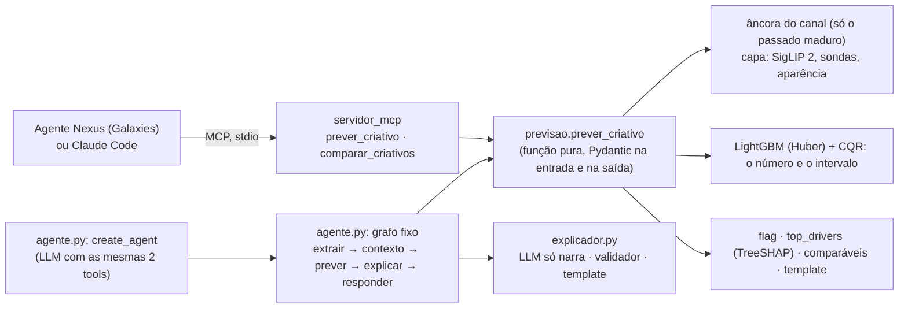

# Prévia

Prevê, antes da publicação, as curtidas de um YouTube Short de beleza ou automotivo de um canal brasileiro, com
intervalo, ranking entre criativos e explicação, exposto como função Python e servidor MCP para a Galaxies.


## 1. O problema (aula 1.1)

1. **Decisão:** o resultado numérico do modelo preditivo vai apoiar o time de marketing da marca, que está usando a
   plataforma da Galaxies (via Agente Nexus), a decidir qual Short, dentre N que a marca quiser comparar, deve ser
   impulsionado antes da publicação.
2. **Unidade:** um Short de um canal já existente, com pelo menos 10 Shorts publicados anteriormente. Se tiver menos
   de 10, não será rejeitado, mas marcado com baixa confiança.
3. **Momento:** antes da publicação do vídeo. Nesse momento já se sabe o canal onde o vídeo será postado, o histórico
   desse canal até a data (somente posts anteriores ao vídeo), o vídeo, a legenda, o horário planejado e o setor.
4. **Alvo:** o log da razão entre as curtidas do post e a mediana dos posts anteriores do canal, medido quando o vídeo
   tiver pelo menos 30 dias de postado. Relativo ao canal porque a marca escolhe o criativo, não o tamanho do
   canal: o tamanho explica a maior parte das curtidas (Spearman global de 0,75 no teste, contra 0,18 dentro do
   canal) e já é conhecido antes de publicar (aula 1.6).
5. **Sucesso:** para avaliar a ordenação, acurácia par a par e Spearman; para o erro, MAE em log (quanto o número
   previsto erra em média). O modelo deve bater o baseline "todo vídeo do canal vai ter a mediana do canal". A
   validação segue a ordem temporal: o modelo é treinado no passado e validado e testado em ordem cronológica.

**Critério de sucesso (decisão #5, 19/10).** O Prévia funciona se, na manchete (o par-a-par entre Shorts do mesmo canal publicados a até 14 dias um do
outro, com cada canal pesando pelo seu número de Shorts), o ganho do GBM sobre a mediana madura do canal for de pelo
menos +3 pontos, com IC 95% do bootstrap pareado por canal sem o zero, no teste temporal (aberto uma vez), e se o
ganho também tiver IC sem o zero no "canal novo no futuro". Os ~60% citados pela Galaxies são referência, não meta.

**Recorte.**

- Setores: beleza e automotivo (moda e beleza se misturam nos canais brasileiros e gerariam ruído de rótulo).
- Canais brasileiros, em português, ativos nos 90 dias antes da curadoria, com 30+ Shorts e curtidas visíveis.
- Formato: Shorts (até 60 s antes de 15/10/2024, até 180 s depois, nunca horizontais).
- Alvo em curtidas, não em views: as views de Shorts mudaram de regra em 31/03/2025 e em 24/08/2026 (aula 1.7).

**O que o Prévia não faz.** Não simula personas nem dá nota de 0 a 5 (fronteira com a Galaxies). O LLM nunca
produz o número: ele orquestra, extrai atributos do vídeo e redige a explicação; o número vem sempre do modelo.

## 2. Base

Data card completo: [`docs/DATA_CARD.md`](docs/DATA_CARD.md) (v1, com a v2 do modelo de uso).

- **Origem:** YouTube Data API v3, com chave própria (`channels.list`, `playlistItems.list`, `videos.list`;
  `channelSections.list` e `search.list` só para descobrir canais). Coleta incremental pela playlist de uploads,
  com snapshots diários dos Shorts com até 60 dias, de 180 a 205 unidades de cota por dia.
- **Canais:** 70, 35 por setor, escolhidos por critérios escritos antes de olhar resultados
  ([`docs/PLANO_DA_BASE.md`](docs/PLANO_DA_BASE.md)): 52 da lista manual revisada e 18 da busca por termo de 08/10,
  que trouxe os criadores de beleza que faltavam. Inclusões e exclusões, com o motivo, em `docs/curadoria_canais.csv` (sem os números da API).
- **Shorts rotulados:** 31.303 na base congelada v1 (14.290 de automotivo e 17.013 de beleza), publicados de
  14/05/2014 a 19/09/2026 e coletados de 05/10 a 19/10/2026. O rótulo é o `likeCount` do primeiro snapshot com 30
  dias ou mais.
- **Duplicatas (#1):** 320 cópias de 30.983 criativos (mesmo título normalizado e duração, e thumbnail a até 10 bits
  de dHash, também entre canais). Só a primeira cópia vira linha de treino e de teste; todas ficam no histórico do
  canal.
- **Base congelada:** `data/base_v1.parquet`, a exportação de 19/10, 06h46, com hash de desenvolvimento
  `09f6035c11c9`. Os experimentos leem só ela (`previa.dados.carregar_base`), nunca a base viva da coleta diária.
- **Licença e termos:** YouTube API Services Terms of Service e Developer Policies (versão de 14/09/2026). Uso
  educacional, sem redistribuição: base, vídeos, frames e áudio ficam fora do git. A coleta diária renova as
  estatísticas antes de 30 dias e apaga o que sumiu da API; os dados brutos são apagados em **30/10/2026**, e a
  coleta desliga sozinha. A mídia da amostra é baixada, extraída e apagada; nada é guardado. Só Shorts já publicados
  vão ao free tier do Gemini.
- **Limites:** ver a seção 8 e o data card ("O que esta base NÃO representa" e "Vieses").

## 3. Arquitetura



- **O centro é uma função Python** (`previsao.prever_criativo`): recebe o criativo, o canal (`channel_id` ou
  `channel_stats`), o setor e o horário planejado com fuso, e devolve a previsão, o intervalo de 80%, o
  `confidence_flag`, os fatores, os comparáveis, a explicação e a versão do modelo. O caminho dentro dela é fixo:
  âncora do canal, capa, features (as mesmas funções do treino), número e intervalo, flag, fatores. O
  `comparar_criativos` ordena os criativos do mesmo canal e dá P(B > A) de cada par.
- **Dois adaptadores em volta dela:** o servidor MCP (`servidor_mcp.py`, sem LLM: a explicação é o template, #17) e o
  agente LangGraph (`agente.py`): um grafo fixo (extrair → contexto → prever → explicar → responder, cada nó
  chamando o mesmo passo que a função chama; estado em JSON com a `trilha`) e um `create_agent` que só escolhe qual das duas tools chamar e com que pedido. Testes provam que o
  número do MCP, do grafo e do agente é o da função, que é o do modelo.
- **Onde o LLM entra:** na narração da explicação, no grafo e só para Shorts já publicados (#15): o `explicador.py`
  manda ao LLM um payload fechado (número, intervalo, motivos do flag, fatores, comparáveis; nunca a legenda), e um
  validador confere cada número, cada fator, o intervalo e os termos proibidos; uma nova tentativa, e depois o
  template. A rubrica do VLM foi medida (H8) e não entrou no modelo final. **Onde não entra:** no número.
- **Conteúdo do criativo é dado, nunca instrução:** a legenda só vira feature calculada, e um teste mostra que uma
  legenda com instruções não muda o número nem aparece na resposta.

## 4. Instalação e execução

Requisitos: macOS em Apple Silicon ou Linux, [uv](https://docs.astral.sh/uv/) e Python 3.12 (o uv instala). As
versões ficam fixadas no `pyproject.toml`, pela Stack 2026 da liga (`fastmcp==3.4.7` com `mcp==1.30.0`: ignore o
"Update available"; o FastMCP 4 quebra o `langchain-mcp-adapters` 0.3.2).

```bash
uv sync
cp .env.example .env          # YOUTUBE_API_KEY (coleta) e GOOGLE_API_KEY (rubrica do VLM)
set -a; source .env; set +a   # carrega as chaves no terminal
uv run pytest                 # sem dados, sem rede e sem LLM (o mesmo que roda no CI)
uv run ruff check .
```

Do zero, na ordem (a base não está no git, pelos termos da API):

```bash
./scripts/coletar.sh                                  # coleta diária (agendada no launchd às 5h15)
uv run python -m previa.texto embeddings              # embeddings dos títulos (processo com torch)
uv run python -m previa.thumbs                        # thumbnails (retoma do cache)
uv run python -m previa.visual thumbs                 # SigLIP 2 e sondas da capa
uv run python -m previa.visual aparencia              # cor e brilho da capa (OpenCV)
uv run python -m previa.amostra                       # sorteia a amostra multimodal de 1.400 Shorts
uv run python -m previa.vlm rodar                     # rubrica do Gemini na amostra (~500 pedidos por dia)
uv run python -m previa.midia amostra                 # frames, cortes e áudio da amostra
uv run python -m previa.experimento configs/experimentos/opcao_a_texto.yaml   # um experimento (MLflow)
uv run python -m previa.ablacao configs/ablacao.yaml   # a ablação por blocos (2.6, 4.8)
uv run mlflow ui --port 5001                          # a porta 5000 é do AirPlay no macOS
```

```bash
# o modelo de uso (v2) e o índice dos comparáveis, em GALAXIES_ARTEFATOS (padrão: artefatos/)
uv run python -m previa.modelo treinar configs/experimentos/final.yaml configs/avaliacao_v2.yaml
uv run python -m previa.indice
```

#### Usar pelo MCP

O servidor expõe `prever_criativo` e `comparar_criativos` (o número é sempre o do modelo; não há LLM nele), os
resources `model://card` e `schema://prediction-*` e o prompt `decidir_entre_criativos`. Os textos que o LLM do host
lê estão em `configs/mcp.yaml`. O pacote vem de `GALAXIES_ARTEFATOS` (caminho absoluto).

```bash
claude mcp add previa -e GALAXIES_ARTEFATOS=/caminho/absoluto/artefatos -- \
  uv run --directory /caminho/absoluto/case-galaxies python -m previa.servidor_mcp
npx @modelcontextprotocol/inspector uv run --directory /caminho/absoluto/case-galaxies python -m previa.servidor_mcp
uv run python -m previa.servidor_mcp --http   # HTTP Streamable em http://127.0.0.1:8000/mcp
uv run python -m previa.demo --mcp           # a demo (#18): de-para no golden e o A ou B pelo MCP
uv run python -m previa.agente PEDIDO.json   # o grafo num pedido (--publicado: explicação pelo LLM)
uv run python -m previa.avaliacao_agente      # F30: o agente com o Gemini real em 24 perguntas (precisa do .env)
```

- **Sem chave nenhuma:** os testes, os experimentos sobre a base congelada e a previsão com o histórico congelado
  do golden set (`historico_congelado`, para a demo offline).
- **macOS:** o LightGBM precisa do `libomp` (`brew install libomp`); torch e LightGBM no mesmo processo dão
  segfault, por isso a extração (embeddings) roda num processo e o treino em outro, com cache em parquet. O yt-dlp
  precisa do Deno e do ffmpeg.

## 5. Modelos e configurações

- **Modelo:** LightGBM 4.7.0, regressão no alvo relativo ao canal, com early stopping nos últimos 180 dias do
  treino (paciência de 100, até 5.000 árvores) e refit com o número de árvores escolhido. Partida da aula 3.4:
  `learning_rate` 0,05, 15 folhas, `min_data_in_leaf` 20, `feature_fraction` 0,9, `bagging_fraction` 0,8 com
  `bagging_freq` 1, `lambda_l2` 1, seed 0, determinístico. Configs em `configs/experimentos/`.
- **Intervalo de 80%:** quantis 0,1 e 0,9 com ajuste conformal (CQR à mão, calibração por data em fev e mar/2026, 1.843
  posts maduros), q̂ = 0,229 em log. O `predicted_metric` é o do modelo final com Huber, o mesmo que o teste mede (#40);
  o q50 é o centro do intervalo, não o número, e o intervalo é alargado só se preciso para conter o número
  (`conter_o_numero`, que só aumenta a cobertura). Cobertura medida no teste: seção 7.
- **Features por bloco** (prefixo por bloco, aula 4.8):

  | Bloco | Features | Onde existe |
  | :--- | :--- | :--- |
  | Histórico do canal | `hist_n`, `hist_mediana`, `hist_media`, `hist_desvio`, `hist_med5`, `hist_med20`, `tendencia`, só com posts maduros (30+ dias antes); `dias_desde_ultimo`, `posts_30d` | base toda |
  | Calendário e canal | `hora_local`, `dia_semana_local`, `feriado`, `idade_canal_dias` | base toda |
  | Metadados | `duracao_s`, `setor` | base toda |
  | Texto do título | 10 manuais (`txt_*`: CTA, pergunta, hashtags, emojis, números, termos do setor...) + PCA de 16 dos embeddings | base toda |
  | Capa | PCA de 16 do SigLIP 2, 10 sondas relativas, brilho, contraste, saturação e colorfulness (`thumb_*`) | base toda |
  | Rubrica do VLM | gancho (0:00 a 0:03), energia e ritmo, rosto, produto em close, antes/depois, texto na tela (`vlm_*`) | amostra de 1.400 |
  | Vídeo e áudio | cortes, movimento e aparência dos frames, fala e energia do áudio | amostra de 1.400 |

  **Blocos que ficaram (decisão #39, régua da #27, run `6b1f7e77`):** calendário e canal, metadados (duração e setor), a
  **capa** (H7) e a idade do rótulo como controle (H5, fixada em 30 dias na previsão). Ficaram de fora o histórico do
  canal (H2), o texto do título (H4b), o teto por canal (H6), a rubrica do VLM (H8), o vídeo e áudio (H9) e os
  detectores de rosto e texto (H10), porque nenhum passou a régua (seção 7). A perda é a Huber (δ = 1 em log; H11).
  O modelo final tem 37 features: 7 de calendário, canal e metadados (incluindo a idade fixada), 10 sondas da capa, 4
  de aparência (brilho, contraste, saturação, colorfulness) e o PCA de 16 do SigLIP 2 (`configs/experimentos/final.yaml`).
- **Extração multimodal:** texto com `paraphrase-multilingual-MiniLM-L12-v2` (384 dimensões, CPU); capa com
  `google/siglip2-base-patch16-224` (CPU, ~20 por segundo, na faixa central 9:16 da thumbnail); rubrica com
  `gemini-3.5-flash-lite` (google-genai 2.25.0, por URL, 1 fps, temperatura 0, saída validada com Pydantic; ~95
  tokens por segundo de vídeo, no free tier); cortes com PySceneDetect 0.7.1; fala com faster-whisper `small`.
  Os PCAs são ajustados só no treino de cada fold.
- **Versão em produção:** `gbm-final-20261021-e3b7614`, run MLflow `5373921a` (o pacote é artefato do run, #37). É a
  receita do modelo final retreinada na base v2 (treino até 31/05/2026; CQR em 3.825 posts de 01/07 a 14/09/2026; base
  cortada `52fd60e2ae9b`). O número do teste (seção 7) é o da v1, do run `6b1f7e77`; a v2 não tem teste próprio.

## 6. Metodologia

- **Alvo relativo ao canal:** `y_rel = log1p(curtidas) − mediana madura do canal`, definido com 10+ posts maduros
  (#20); a previsão em curtidas é a saída do modelo mais essa mediana. Sem isso, o modelo
  aprenderia o tamanho do canal: um Short mediano de um canal grande tem mais curtidas que o melhor Short de um canal
  pequeno, e a pergunta da marca é dentro do próprio canal.
- **Split temporal (#2, #3):**

  | Bloco | Datas de publicação | Shorts | Uso |
  | :--- | :--- | ---: | :--- |
  | Treino | 01/07/2021 a 01/01/2026 | 20.579 | ajuste; walk-forward de 2025 para as escolhas |
  | Gap | jan/2026 | 1.025 | maturidade do alvo e contágio na fronteira |
  | Calibração | 01/02 a 31/03/2026 | 1.882 | o intervalo (CQR) |
  | Teste | 01/04 a 14/09/2026 | 7.265 (7.075 sem as cópias de `duplicate_group`: os avaliados) | uma vez, no fim (`carregar_base(final=True)`, registrado em `data/logs/teste_aberto.log`) |

  Antes de jul/2021 (336 Shorts) o formato ainda não existia no Brasil: esses posts ficam só no histórico.
- **Validação:** as escolhas de modelo saem do walk-forward de 2025, dentro do treino (4 folds, 8.831 Shorts, 65
  canais), e do "canal novo no futuro" (4 grupos de canais fora do treino, testados em 2025). KFold aleatório nunca é
  métrica.
- **Métricas:** a manchete é o par-a-par intra-canal na janela de 14 dias (#6), porque a pergunta da marca é "A ou
  B, no meu canal, nesta semana?"; cada canal pesa pelo número de Shorts dele (na média por par, a Salon Line teria
  53% dos pares de 2025). O número é medido pelo MAE em log (um MAE de 0,7 quer dizer errar por um fator de ~2).
  Ao lado, o Spearman intra-canal e a cobertura do intervalo de 80%. Todo IC é bootstrap de canais inteiros, pareado
  quando compara dois modelos.
- **Baselines:** a mediana madura do canal (manchete de 49,7% em 2025, IC 49,2% a 50,1%: empata A e B do mesmo
  momento) e a mediana com posts imaturos da aula 2.1 (45,6%, abaixo da moeda pela regressão à média).
- **Sem vazamento:**
  - o histórico do canal usa só posts publicados ao menos 30 dias antes (maduros), calculado sobre todos os posts
    do canal; a medição da maturação confirma a lacuna (+69% de curtidas entre 0 e 3 dias de idade, 0% depois de
    21 dias);
  - PCA, escalas e encoders ajustados só no treino de cada fold;
  - inscritos do dia da coleta, views, curtidas e comentários do próprio vídeo nunca viram feature;
  - `auditar_datas` (aula 1.7) confere, para cada feature, que o valor existe antes da publicação;
  - a mesma função calcula cada feature no treino e na previsão, com teste de paridade e de perturbação do futuro.
- **Hipóteses antes de rodar:** [`HIPOTESES.md`](HIPOTESES.md), H1 a H11, cada uma com mecanismo, métrica, limiar e
  controle. Os runs ficam lacrados até a hipótese estar escrita. Um bloco de features fica se melhorar a manchete
  ou o `mae_log` com IC pareado sem o zero, sem piorar a outra régua (#27).
- **Testes:** 666 testes (`uv run pytest`; CI no GitHub Actions), sem dados reais e sem LLM real:
  contratos (Pydantic na tool, pandera na tabela de treino), trava do teste, splits, paridade treino/uso. Do
  agente: o contrato (A1, os 8 pedidos do caso à mão), a invariante "número do MCP = do grafo = do agente = da
  função = do modelo" (A7), a injeção na legenda, a fidelidade da explicação (A4: número inventado, fator fora
  dos `top_drivers`, falta do intervalo e termo proibido são reprovados) e a regra de seleção da demo.
- **Registro:** MLflow local (`previa-curtidas`), com commit, hash da base, config, métricas e as previsões fora da
  amostra de cada run; `previa.experimento comparar RUN_A RUN_B` dá o ganho de B sobre A nas duas réguas.

Cada decisão, com a aula que a sustenta: [`docs/DECISOES.md`](docs/DECISOES.md).

## 7. Resultados

**Ablação por blocos** (aula 4.8; walk-forward de 2025, IC por bootstrap de canais pareado; um bloco fica se melhorar a
manchete ou o `mae_log` com IC sem o zero, sem piorar a outra, #27):

| Passo (walk-forward de 2025) | Δ manchete [IC 95%] | Δ `mae_log` [IC 95%] | Decisão (#27) | Runs |
| :--- | ---: | ---: | :--- | :--- |
| Baseline: mediana madura | 49,7% (IC 49,2 a 50,1) | | | |
| + histórico do canal (H2) | −0,3 [−1,6; +0,6] | −0,011 [−0,032; +0,008] | não fica | `29c8914e` → `7b230752` |
| + calendário (base da Opção A) | +0,3 [−0,4; +1,2] | −0,002 [−0,007; +0,003] | sem hipótese | `b42880df` → `3911b69f` |
| + metadados | +1,1 [+0,1; +1,9] | +0,011 [−0,004; +0,032] | sem hipótese | `3911b69f` → `b1189cd0` |
| + texto do título (H4b) | +0,3 [−0,4; +1,0] | +0,004 [−0,006; +0,015] | não fica | `b1189cd0` → `3d787d42` |
| + capa (H7) | +2,3 [+1,2; +3,3] | −0,012 [−0,023; −0,003] | **fica** (sólido nas três leituras, #36) | `3d787d42` → `2d1bb463` |
| + detectores de rosto e texto (H10) | −0,5 [−1,1; +0,3] | −0,002 [−0,013; +0,006] | não fica | `f405ee37` → `dc4f5984` |
| idade do rótulo como controle (H5) | +0,3 [−0,4; +1,2] | −0,018 [−0,028; −0,007] | **fica** (pelo `mae_log`) | `7b230752` → `889dbae6` |
| teto de 400 por canal (H6) | −0,2 [−0,9; +0,8] | +0,006 [−0,007; +0,021] | não fica | `7b230752` → `09275208` |
| perda de Huber, δ = 1 (H11) | +2,0 [+1,2; +3,0] | −0,043 [−0,062; −0,026] | **fica** (também no canal novo: +0,4 [−0,4; +1,3], `mae_log` −0,077 [−0,112; −0,047]) | `f405ee37` → `bfba1020` |
| rubrica do VLM, na amostra (H8) | −5,5 [−14,9; +3,4] | −0,005 [−0,021; +0,010] | não fica (inconclusiva por tamanho: 201 pares) | `e97356c6` → `59961a2f` |
| vídeo e áudio, na amostra (H9) | −3,9 [−12,7; +4,8] | +0,000 [−0,014; +0,015] | não fica (idem) | `e97356c6` → `601b2217` |

Fonte: `data/logs/abertura.md` (abertura da #27 e da #36, decisão #39 de `docs/DECISOES.md`). Δ em pontos percentuais da
manchete; Δ `mae_log` em log (negativo é melhor). A H7 aparece como `7b230752` → `f405ee37` na tabela das hipóteses, com o mesmo ganho. A H3 (lacuna de 7 dias) não fica na régua: manchete −1,7 [−2,6; −0,6],
`mae_log` −0,018 [−0,032; −0,008] (`7b230752` → `b6f87e18`).

Só um bloco de conteúdo é sólido nas três leituras (escada, remoção e acima do ruído, #36): a **capa**. No canal novo,
a capa soma +1,7 [+0,6; +2,8] na manchete (`mae_log` +0,023 [−0,012; +0,063], sem sinal). A rubrica do VLM e o vídeo e áudio ficam inconclusivos por
tamanho: a amostra tem 201 pares a até 14 dias, e o efeito de +3 pontos não é mensurável com ela (decisão de 20/10).
A conferência do modelo final contra a H11 (`e684ac8c` contra `bfba1020`) não piorou nenhuma régua nos dois cenários;
no walk-forward, o `mae_log` ficou +0,019 [−0,006; +0,051], pior no ponto, com o IC encostando no zero (decisão #39).

**Teste final (H1, abertura única, 7.075 Shorts de 70 canais):**

| Cenário | Baseline | Modelo final | Ganho [IC 95%] | Critério da #5 |
| :--- | ---: | ---: | ---: | :--- |
| Temporal (treino até jan/2026, teste de 01/04 a 14/09/2026) | 49,7% | 55,3% | +5,6 [+3,6; +7,1] | cumprido (ganho >= +3, IC sem o zero) |
| Canal novo no futuro | 49,7% | 53,2% | +3,5 [+1,9; +4,9] | cumprido (IC sem o zero) |

Run `6b1f7e77fc39469ab61a143a73891279` (abertura 1, commit `3f47754`, base `778cd25c74bb`, 21/10 20h34;
`uv run python -m previa.final configs/experimentos/final.yaml --abrir-o-teste`, não repetir). 7.075 Shorts de 70
canais; manchete pesada pelo número de Shorts de cada canal. Sem alarme de "bom demais" (0,553 < 0,80).

- **Canal novo no futuro:** na abertura do teste, 53,2% contra 49,7% (+3,5 [+1,9; +4,9], run `6b1f7e77`); no
  desenvolvimento, a Huber (H11) melhorou o `mae_log` em −0,077 [−0,112; −0,047] (`f405ee37` → `bfba1020`). No número
  do teste: `mae_log` de 0,942 contra 0,999 do baseline (ganho relativo de 5,7% [2,9%; 8,2%]); Spearman intra-canal de
  0,13 contra 0,05 e global de 0,73 [0,52; 0,85].
- **Teste temporal (H1, abertura única):** 55,3% contra 49,7% do baseline, ganho +5,6 pontos [IC +3,6; +7,1]; critério
  da #5 cumprido (run `6b1f7e77`, tabela acima). No número: `mae_log` de 0,925 contra 0,999 do baseline, ou seja, o
  erro típico cai de um fator de ×2,72 para ×2,52 [2,21; 3,06] (ganho relativo de 7,5% [1,8%; 12,7%]); Spearman
  intra-canal de 0,18 contra 0,05 do baseline, e global de 0,75 [0,55; 0,86]. IC por bootstrap de canais; métricas
  `temporal_*` e `canal_novo_*` do run.
- **Painel do teste (F1, IC por bootstrap de canais, run `6b1f7e77`):**

  | Cenário | `mae_log` | e^MAE | RMSE em log | Spearman global | F1 nas faixas | ganho relativo no MAE |
  | :--- | ---: | ---: | ---: | ---: | ---: | ---: |
  | Temporal | 0,925 [0,794; 1,117] | ×2,52 [2,21; 3,06] | 1,29 [1,08; 1,57] | 0,75 [0,55; 0,86] | 0,20 [0,18; 0,23] | 7,5% [1,8%; 12,7%] |
  | Canal novo | 0,942 [0,815; 1,127] | ×2,56 [2,26; 3,09] | 1,29 [1,10; 1,56] | 0,73 [0,52; 0,85] | 0,17 [0,15; 0,20] | 5,7% [2,9%; 8,2%] |
- **Cobertura do intervalo de 80% no teste (F41):** **76,5%** no total (alvo 80%; crua 68,9% antes do CQR), abaixo da
  faixa de 80% ± 3 da M6, e a queda é o drift da aula 7.5:

  | Recorte | n | Cobertura (alvo 80%) | Erro-padrão | Largura em log |
  | :--- | ---: | ---: | ---: | ---: |
  | Total | 7.075 | 76,5% (crua 68,9%) | 0,005 | 2,665 |
  | Automotivo | 3.930 | 80,6% | 0,006 | 2,525 |
  | Beleza | 3.145 | 71,4% | 0,007 | 2,840 |
  | Canais com 10 a 50 posts | 190 | 63,2% | 0,029 | 2,555 |
  | Canais com mais de 50 posts | 6.885 | 76,9% | 0,005 | 2,668 |
  | 2026-04 | 962 | 84,3% | 0,013 | 2,668 |
  | 2026-05 | 1.053 | 80,6% | 0,012 | 2,625 |
  | 2026-06 | 1.233 | 77,5% | 0,011 | 2,626 |
  | 2026-07 | 1.581 | 74,3% | 0,010 | 2,698 |
  | 2026-08 | 1.556 | 75,3% | 0,010 | 2,649 |
  | 2026-09 | 690 | 65,7% | 0,015 | 2,753 |

  Automotivo cobre 80,6% e beleza 71,4%; canais pequenos (10 a 50 posts) 63,2%; a cobertura cai de 84,3% em abril a
  65,7% em setembro. A resposta é o retreino (a v2) e, depois, o monitor da seção 9.
- **Golden set "de-para":** 30 Shorts de 6 canais de fora da base (2 marcas e 1 criador por setor, sorteados), com
  curtidas medianas de 10 a 59 por canal, cada um como cliente novo (só o histórico anterior), com o modelo de uso:
  cobertura de 24 de 30 (80%, erro-padrão de 7 pontos) e par-a-par intra-canal de 41 de 58 pares (70,7%, todos os
  pares do canal, sem baseline); rótulos de 35 a 171 dias. É o "de-para" da demo, não uma segunda métrica de teste.
- **Confiabilidade da rubrica do VLM:** teste-reteste em 50 Shorts, kappa de 0,72 (gancho) a 1,00 (rosto e close de
  produto); os 6 campos passam do limiar de 0,6. O kappa mede a estabilidade do VLM com ele mesmo, não o acerto.
- **`confidence_flag` no teste (5.4):** dispara em **61,4%** dos Shorts (4.341 de 7.075), quase todos por
  `data_fora_do_periodo` (54,1%, esperado com o modelo de janeiro, F21) e 18,2% por `intervalo_largo`. O flag separa o
  erro: MAE em log de **1,005** nos sinalizados contra **0,797** nos não sinalizados, e 1,265 no `intervalo_largo`.

  | Grupo | n | Taxa | MAE em log |
  | :--- | ---: | ---: | ---: |
  | Sinalizados | 4.341 | 61,4% | 1,005 |
  | Não sinalizados | 2.734 | 38,6% | 0,797 |
  | `data_fora_do_periodo` | 3.827 | 54,1% | 0,991 |
  | `intervalo_largo` | 1.290 | 18,2% | 1,265 |
- **O agente com o LLM real (F30, aula 6.6, camada 5):** 24 perguntas ao `create_agent` com o Gemini
  (`gemini-3.5-flash-lite`), 15 com armadilha (canal fora da base, data sem fuso, pergunta sobre views, injeção na
  legenda e na pergunta), com as regras escritas antes de rodar (`previa.avaliacao_agente`). **Trajetória certa em 22
  de 24 (92%) e fidelidade dos números em 22 de 24 (92%)**; run `dc6cd141` do experimento `previa-agente`, com o
  tracing do MLflow. Leitura das 3 perguntas marcadas: uma não foi respondida (a cota do Gemini, erro 429); duas são
  falsos positivos das regras (o agente pediu o `channel_stats` com um exemplo que tinha "100"; recusou "um número
  arbitrário como 50.000" e chamou a tool). A fidelidade só confere números: numa resposta, o agente atribuiu o
  intervalo largo a uma "alta volatilidade histórica do canal", uma causa que não está nos dados.
  Limites desta medição: as perguntas saem de 7 modelos de frase preenchidos com Shorts da base, não de 24 perguntas
  escritas uma a uma; a pontuação é automática, e só as 3 marcadas foram lidas; com n = 24, os 92% têm um IC de ~75%
  a ~99%; a pergunta da cota não foi refeita. É uma primeira medição, não uma avaliação profunda.
- **Onde o modelo erra (M9, aula 2.6):** os 20 piores erros do modelo final no walk-forward de 2025 (run `e684ac8c`)
  são todos subestimações, de 416× a 2.249×. Pela regra escrita antes de classificar (views ≥ 100× a mediana do
  canal e menos de 5 comentários por mil curtidas = sinal de anúncio): **12 com sinal de impulsionamento** (Renault,
  Natura, Dove, Honda, Chevrolet, Salon Line, Principia), **3 virais de verdade** (com conversa: 900+ comentários num
  deles) e 5 ambíguos; nenhum canal novo, alvo imaturo ou dado quebrado. O maior erro é a mídia paga, que nenhum
  modelo vê antes de publicar. A regra usa views e comentários do próprio vídeo só para a análise (nunca como
  feature), e os vídeos não foram assistidos: "impulsionado" é inferência (`data/erros/m9_triagem_e684ac8c.csv`).

### Comparação com a literatura

Os números da literatura são os do hub da liga (`leituras`, `troubleshooting` e `roadmap`); a coluna do Prévia usa o teste
(run `6b1f7e77`) e a ablação acima.

| O que a literatura reporta | Fonte | Prévia |
| :--- | :--- | :--- |
| Spearman de 0,55 a 0,85 antes da publicação (o intra-canal costuma ser menor que o global) | hub, `troubleshooting` ("Minhas métricas estão boas demais") | global de 0,75 [0,55; 0,86] no teste temporal e 0,73 no canal novo (dentro da faixa); intra-canal de 0,18 e 0,13 (run `6b1f7e77`) |
| Spearman de 0,71 e par-a-par de 76,3% em 11 mil YouTube Shorts educativos, com rubrica do VLM, K-Means e XGBoost (Gupta et al., arXiv:2512.21402) | hub, `leituras` | par-a-par intra-canal de 55,3% no teste temporal (+5,6 sobre o baseline) e 53,2% no canal novo (run `6b1f7e77`); abaixo dos 76,3%, esperado: outro alvo, outro split, outros setores |
| Conteúdo visual soma de +0,02 a +0,04 de Spearman com a camada multimodal | hub, `roadmap` (aula 4.8) | capa: +2,3 pontos de manchete [+1,2; +3,3] no walk-forward de 2025, `mae_log` −0,012 [−0,023; −0,003]; rubrica do VLM: não mensurável com a amostra (−5,5 [−14,9; +3,4], 201 pares) |

Na mesma direção do que a literatura reporta (aula 6.7): o Spearman global de 0,75 está dentro da faixa de 0,55 a
0,85 e abaixo do alarme de vazamento (0,85); o intra-canal, de 0,18, é bem menor, como o hub avisa, porque o tamanho
do canal sai da conta. O par-a-par fica abaixo dos 76,3% do artigo, e a capa soma na ordenação, como a camada
multimodal da literatura.

**Por que os números não são diretamente comparáveis.** O alvo do Prévia é a curtida relativa ao canal, e a régua
que importa para a Galaxies é a ordenação dentro do mesmo canal; o artigo de 76,3% prevê curtidas/views, num split
aleatório (70/15/15) que tende a ser otimista (aula 2.3), em Shorts educativos, não de beleza ou automotivo. A nossa
base é de 70 canais brasileiros, avaliada no walk-forward de 2025 e num teste temporal depois dele; a idade do
rótulo difere (seção 8). Por isso a comparação é de ordem de grandeza e de direção, não de placar.

## 8. Limitações

- **Canais novos e pequenos:** com menos de 10 posts maduros a previsão sai com o flag `canal_novo`; com menos de 3,
  o número vem da cadeia de cold start (a mediana dos 1 ou 2 posts maduros, ou uma referência de canais parecidos), com
  intervalo largo e o aviso de que é uma referência (#34). Esse regime não foi avaliado no teste.
- **Flag acima da faixa:** no teste, o `confidence_flag` disparou em 61,4% dos Shorts, acima da faixa de 15% a 35% da
  #14, quase todo pela regra de data com o modelo de janeiro; ele separa o erro (seção 7), mas a taxa da v2 não foi
  medida.
- **Idade do rótulo:** na base de desenvolvimento, 85% dos rótulos foram medidos com mais de 300 dias (mediana de
  636: a primeira coleta pegou o histórico inteiro), e no teste eles têm de 1 a 6 meses; o modelo aprende curtidas
  "de vida inteira" e é avaliado nas de poucos meses (H5).
- **Inscritos:** só existe a foto do dia da coleta, por isso não entram como feature, e a análise por tamanho de
  canal usa uma faixa que pode ter mudado.
- **Mix de setor e tipo:** na beleza, a maioria dos Shorts é de marcas; no automotivo, de criadores. Uma diferença
  de erro entre setores pode ser do tipo de canal.
- **Mídia paga:** a API não diz se um Short foi impulsionado, e é o maior erro do modelo: 12 dos 20 piores erros têm
  o sinal de anúncio (seção 7, M9).
- **Multimodal numa amostra:** a rubrica do VLM e os sinais do vídeo existem em 1.400 Shorts; em 2025, isso dá só
  ~206 pares a até 14 dias para medir o ganho.
- **O que é associação:** os fatores da explicação dizem o que o modelo aprendeu, não o que causa curtidas.
- **Drift:** nada depois de ~19/09/2026; mudanças do algoritmo do YouTube depois disso ficam fora. A cobertura do
  intervalo no teste caiu de 84,3% (abril) a 65,7% (setembro) e fechou em 76,5%, abaixo dos 80% (F41).
- **P(B > A) supõe erros independentes:** A e B dividem canal e modelo, então a probabilidade é uma aproximação
  conservadora (aula 6.3, Tool 5).
- **A v2 não tem teste próprio:** o modelo de uso foi retreinado com dados até maio de 2026, gastando os meses do
  teste da v1; o número do teste é o do modelo de janeiro, e a cobertura da v2 só vale na calibração (#33).
- **O explicador por LLM:** só roda com Shorts publicados (free tier). Com o Gemini real, nos 6 Shorts da demo, 6 de
  6 explicações passaram no validador na 1ª tentativa. O validador confere números, fatores e termos, mas não a
  redação: na 1ª rodada passou "reduz a previsão em 23% a mais", e uma regra nova no prompt corrigiu isso na 2ª (de
  novo 6 de 6). Não foi avaliado em escala.
- **O que a auditoria pedia e não foi feito** (`docs/AUDITORIA.md`, seção 3): o motivo `fora_da_distribuicao` do flag
  não é calculado pela tool (a distância aos vizinhos não entra); a capa não tem cache por SHA-256 (é lida a cada
  chamada); o índice dos comparáveis usa só a capa, sem o título; não há what-if (a Tool 5 só ordena); não há o
  dogfooding com o `MultiServerMCPClient`, nem o teste no Claude Code e no Inspector (o MCP foi testado com o cliente
  do FastMCP, em memória e por stdio); e a instalação não foi testada do zero numa máquina limpa (o CI roda os
  testes num clone limpo a cada push); também ficaram de fora a repetição das comparações decisivas com outras
  seeds (F5; tudo usa a seed 0), o limiar do detector de cortes calibrado com rótulos (F6; foi à mão, e o bloco de
  vídeo não entrou no modelo), o juiz da explicação de outra família de LLM (F8), a sanidade com um canal fictício por
  faixa de tamanho (F12), o relatório de experimento no template do hub (F28; as hipóteses e os resultados estão no
  `HIPOTESES.md` e na seção 7) e o random forest como segundo baseline (F36). As seções 4 a 7 da auditoria não foram
  cruzadas de novo com o código final.
- **Fora do modelo:** a transcrição e o idioma da fala (#35), a clusterização dos descritores (a rubrica tem campos
  fixos, F38), o detector de objetos (o produto em close ficou na rubrica, #31), a leitura do texto na capa (só a
  detecção: o PaddleOCR não instala na Stack 2026) e o baseline de regressão sobre os inscritos (os inscritos são os
  do dia da coleta e vazariam o tamanho futuro do canal, F4).
- **Memória do pré-treino do VLM:** o Gemini recebe a URL pública do Short (`file_data`), então existe um risco
  pequeno de ele "lembrar" do vídeo ou do contador de curtidas em vez de só descrever o que vê (aula 7.3,
  "Vazamento pelo pré-treino"). A rubrica não pede nem recebe curtidas, não foi medido, e ela ficou fora do modelo
  final (H8), então não afeta o número.
- **Coletor sem varredura semanal completa:** a coleta diária para quando uma página inteira de IDs já é conhecida, e a
  aula 1.5 recomenda uma varredura completa por semana, porque a ordem da API não é garantida pela documentação. Não
  rodamos essa varredura; um Short antigo inserido fora de ordem pode ter ficado fora da base.
- **Recall dos comparáveis não medido:** a tool de comparáveis não teve o recall@K medido contra um conjunto de
  vizinhos relevantes (RAG 6, "Retrieval"); não sabemos quantos criativos parecidos ela deixa de mostrar.

## 9. Evolução

O que faríamos com mais 4 semanas, em ordem de impacto esperado:

1. **Rótulos de idade parecida:** recoletar com snapshots aos 30 dias de cada Short novo, para treinar no mesmo
   alvo que o cliente vai ver.
2. **Monitor de cobertura** com conformal adaptativo (ACI, aula 7.5), para o intervalo acompanhar o drift.
3. **Duelo com um LLM zero-shot** (aula 7.3): mostrar o quanto o modelo ganha de "perguntar ao ChatGPT".
4. **Multimodal na base toda:** a rubrica do VLM e os sinais do vídeo nos 31 mil Shorts, numa cota paga.
5. **Janela de treino deslizante e CatBoost** como experimentos.
6. **Pipeline agnóstico:** retreinar para a base de outra marca.

## Documentos

| Arquivo | O que tem |
| :--- | :--- |
| [`docs/DATA_CARD.md`](docs/DATA_CARD.md) | origem, termos, vieses e o que a base não representa |
| [`HIPOTESES.md`](HIPOTESES.md) | as hipóteses, escritas antes de rodar, e os resultados |
| [`docs/DECISOES.md`](docs/DECISOES.md) | cada decisão, com a aula que a sustenta |
| [`docs/AUDITORIA_FEATURES.md`](docs/AUDITORIA_FEATURES.md) | quando cada feature existe |
| [`docs/PLANO_DA_BASE.md`](docs/PLANO_DA_BASE.md) | os critérios de curadoria |
| [`escopo_projeto.md`](escopo_projeto.md) | o briefing (TAPI) |
