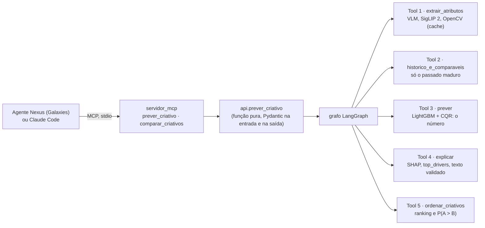

# Prévia

Prevê, antes da publicação, as curtidas de um YouTube Short de beleza ou automotivo de um canal brasileiro, com
intervalo, ranking entre criativos e explicação, exposto como função Python e servidor MCP para a Galaxies.

<!--
RASCUNHO DO CLAUDE (20/10, corte #25, aula 6.7), a partir do docs/DECISOES.md, do HIPOTESES.md e do
docs/DATA_CARD.md. O Vinicius reescreve na A8. Marcas:
  <!- V: ... ->          texto que é do Vinicius (o porquê do alvo, o critério de sucesso, as leituras)
  <!- PREENCHER: ... ->  número que sai de um run lacrado, do teste (abertura única) ou de uma peça a fazer
A seção 1 é o texto do Vinicius de 05/10, sem mudança. As seções seguem o briefing (TAPI, entregáveis) e o
template da 6.7.
-->

## 1. O problema (aula 1.1)

1. **Decisão:** o resultado numérico do modelo preditivo vai apoiar o time de marketing da marca, que está usando a
   plataforma da Galaxies (via Agente Nexus), a decidir qual Short, dentre N que a marca quiser comparar, deve ser
   impulsionado antes da publicação.
2. **Unidade:** um Short de um canal já existente, com pelo menos 10 Shorts publicados anteriormente. Se tiver menos
   de 10, não será rejeitado, mas marcado com baixa confiança.
3. **Momento:** antes da publicação do vídeo. Nesse momento já se sabe o canal onde o vídeo será postado, o histórico
   desse canal até a data (somente posts anteriores ao vídeo), o vídeo, a legenda, o horário planejado e o setor.
4. **Alvo:** o log da razão entre as curtidas do post e a mediana dos posts anteriores do canal, medido quando o vídeo
   tiver pelo menos 30 dias de postado. <!-- TODO(Vinicius): o porquê do alvo, depois da aula 1.6 -->
5. **Sucesso:** para avaliar a ordenação, acurácia par a par e Spearman; para o erro, MAE em log (quanto o número
   previsto erra em média). O modelo deve bater o baseline "todo vídeo do canal vai ter a mediana do canal". A
   validação segue a ordem temporal: o modelo é treinado no passado e validado e testado em ordem cronológica.

**Critério de sucesso (decisão #5, 19/10).** <!-- V: juntar ao item 5 com as suas palavras -->
Rascunho: o Prévia funciona se, na manchete (o par-a-par entre Shorts do mesmo canal publicados a até 14 dias um do
outro, com cada canal pesando pelo seu número de Shorts), o ganho do GBM sobre a mediana madura do canal for de pelo
menos +3 pontos, com IC 95% do bootstrap pareado por canal sem o zero, no teste temporal (aberto uma vez), e se o
ganho também tiver IC sem o zero no "canal novo no futuro". Os ~60% citados pela Galaxies são referência, não meta.

**Recorte.**

- Setores: beleza e automotivo (moda e beleza se misturam nos canais brasileiros e gerariam ruído de rótulo).
- Canais brasileiros, em português, ativos nos 90 dias antes da curadoria, com 30+ Shorts e curtidas visíveis.
- Formato: Shorts (até 60 s antes de 15/10/2024, até 180 s depois, nunca horizontais).
- Alvo em curtidas, não em views: as views de Shorts mudaram de regra em 31/03/2025 e em 24/08/2026 (aula 1.7).

**O que o Prévia não faz.** Não simula personas nem dá nota de 0 a 5 (fronteira com a Galaxies). O LLM nunca
produz o número: ele orquestra, extrai atributos do vídeo e redige a explicação; o número vem sempre do modelo.

## 2. Base

Data card completo: [`docs/DATA_CARD.md`](docs/DATA_CARD.md). <!-- PREENCHER: o data card ainda é a v0.1 de
08/10; a versão final traz os números abaixo -->

- **Origem:** YouTube Data API v3, com chave própria (`channels.list`, `playlistItems.list`, `videos.list`;
  `channelSections.list` e `search.list` só para descobrir canais). Coleta incremental pela playlist de uploads,
  com snapshots diários dos Shorts com até 60 dias, de 180 a 205 unidades de cota por dia.
- **Canais:** 70, 35 por setor, escolhidos por critérios escritos antes de olhar resultados
  ([`docs/PLANO_DA_BASE.md`](docs/PLANO_DA_BASE.md)): 52 da lista manual revisada e 18 da busca por termo de 08/10,
  que trouxe os criadores de beleza que faltavam. Inclusões e exclusões, com o motivo, em `data/canais.csv`.
- **Shorts rotulados:** 31.303 na base congelada v1 (14.290 de automotivo e 17.013 de beleza), publicados de
  14/05/2014 a 19/09/2026 e coletados de 05/10 a 19/10/2026. O rótulo é o `likeCount` do primeiro snapshot com 30
  dias ou mais.
- **Duplicatas (#1):** 320 cópias de 30.983 criativos (mesmo título normalizado e duração, e thumbnail a até 10 bits
  de dHash, também entre canais). Só a primeira cópia vira linha de treino e de teste; todas ficam no histórico do
  canal.
- **Base congelada:** `data/base_v1.parquet`, a exportação de 19/10, 06h46, com hash de desenvolvimento
  `09f6035c11c9`. Os experimentos leem só ela (`previa.dados.carregar_base`), nunca a base viva da coleta diária.
- **Licença e termos:** YouTube API Services Terms of Service e Developer Policies (versão de 14/09/2026). Uso
  educacional, sem redistribuição: base, vídeos, frames e áudio ficam fora do git. A coleta diária renova as
  estatísticas antes de 30 dias e apaga o que sumiu da API; os dados brutos são apagados em **30/10/2026**, e a
  coleta desliga sozinha. A mídia da amostra é baixada, extraída e apagada; nada é guardado. Só Shorts já publicados
  vão ao free tier do Gemini.
- **Limites:** ver a seção 8 e o data card ("O que esta base NÃO representa" e "Vieses").

## 3. Arquitetura

<!-- PREENCHER: conferir os nomes com a A1 (contrato), a A2 (servidor MCP) e a A6 (grafo) quando existirem -->



- **O centro é uma função Python** (`prever_criativo`): recebe o criativo, o canal, o setor e o horário planejado
  e devolve a previsão, o intervalo de 80%, o `confidence_flag`, os fatores e a versão do modelo. O MCP e o grafo
  são adaptadores em volta dela; um teste prova que o número do agente, do MCP e da função é o mesmo.
- **Onde o LLM entra:** na extração de atributos do vídeo (a rubrica do VLM, Tool 1) e na redação da explicação
  (Tool 4), que um validador confere contra os números do modelo antes de sair. **Onde não entra:** no número.
- **Conteúdo do criativo é dado, nunca instrução:** legenda, texto na tela e fala podem conter prompt injection, e
  um teste mostra que uma legenda com instruções não muda o número.

## 4. Instalação e execução

Requisitos: macOS em Apple Silicon ou Linux, [uv](https://docs.astral.sh/uv/) e Python 3.12 (o uv instala). As
versões ficam fixadas no `pyproject.toml`, pela Stack 2026 da liga (`fastmcp==3.4.7` com `mcp==1.30.0`: ignore o
"Update available"; o FastMCP 4 quebra o `langchain-mcp-adapters` 0.3.2).

```bash
uv sync
cp .env.example .env          # YOUTUBE_API_KEY (coleta) e GOOGLE_API_KEY (rubrica do VLM)
set -a; source .env; set +a   # carrega as chaves no terminal
uv run pytest                 # sem dados, sem rede e sem LLM (o mesmo que roda no CI)
uv run ruff check .
```

Do zero, na ordem (a base não está no git, pelos termos da API):

```bash
./scripts/coletar.sh                                  # coleta diária (agendada no launchd às 5h15)
uv run python -m previa.texto embeddings              # embeddings dos títulos (processo com torch)
uv run python -m previa.thumbs                        # thumbnails (retoma do cache)
uv run python -m previa.visual thumbs                 # SigLIP 2 e sondas da capa
uv run python -m previa.visual aparencia              # cor e brilho da capa (OpenCV)
uv run python -m previa.amostra                       # sorteia a amostra multimodal de 1.400 Shorts
uv run python -m previa.vlm rodar                     # rubrica do Gemini na amostra (~500 pedidos por dia)
uv run python -m previa.midia amostra                 # frames, cortes e áudio da amostra
uv run python -m previa.experimento configs/experimentos/opcao_a_texto.yaml   # um experimento (MLflow)
uv run python -m previa.ablacao configs/ablacao.yaml   # a ablação por blocos (2.6, 4.8)
uv run mlflow ui --port 5001                          # a porta 5000 é do AirPlay no macOS
```

<!-- PREENCHER (A2): o comando do servidor e o do treino do modelo de uso -->

```bash
uv run python -m previa.servidor_mcp                  # servidor MCP (stdio)
claude mcp add previa -- uv run --directory /caminho/absoluto/case-galaxies python -m previa.servidor_mcp
```

- **Sem chave nenhuma:** os testes, os experimentos sobre a base congelada e a previsão com o histórico congelado
  do golden set (`historico_congelado`, para a demo offline).
- **macOS:** o LightGBM precisa do `libomp` (`brew install libomp`); torch e LightGBM no mesmo processo dão
  segfault, por isso a extração (embeddings) roda num processo e o treino em outro, com cache em parquet. O yt-dlp
  precisa do Deno e do ffmpeg.

## 5. Modelos e configurações

- **Modelo:** LightGBM 4.7.0, regressão no alvo relativo ao canal, com early stopping nos últimos 180 dias do
  treino (paciência de 100, até 5.000 árvores) e refit com o número de árvores escolhido. Partida da aula 3.4:
  `learning_rate` 0,05, 15 folhas, `min_data_in_leaf` 20, `feature_fraction` 0,9, `bagging_fraction` 0,8 com
  `bagging_freq` 1, `lambda_l2` 1, seed 0, determinístico. Configs em `configs/experimentos/`.
- **Intervalo de 80%:** <!-- PREENCHER (M6): quantis 0,1/0,5/0,9 + CQR calibrado em fev–mar/2026 -->
- **Features por bloco** (prefixo por bloco, aula 4.8):

  | Bloco | Features | Onde existe |
  | :--- | :--- | :--- |
  | Histórico do canal | `hist_n`, `hist_mediana`, `hist_media`, `hist_desvio`, `hist_med5`, `hist_med20`, `tendencia`, só com posts maduros (30+ dias antes); `dias_desde_ultimo`, `posts_30d` | base toda |
  | Calendário e canal | `hora_local`, `dia_semana_local`, `feriado`, `idade_canal_dias` | base toda |
  | Metadados | `duracao_s`, `setor` | base toda |
  | Texto do título | 10 manuais (`txt_*`: CTA, pergunta, hashtags, emojis, números, termos do setor...) + PCA de 16 dos embeddings | base toda |
  | Capa | PCA de 16 do SigLIP 2, 10 sondas relativas, brilho, contraste, saturação e colorfulness (`thumb_*`) | base toda |
  | Rubrica do VLM | gancho (0:00 a 0:03), energia e ritmo, rosto, produto em close, antes/depois, texto na tela (`vlm_*`) | amostra de 1.400 |
  | Vídeo e áudio | cortes, movimento e aparência dos frames, fala e energia do áudio | amostra de 1.400 |

  <!-- PREENCHER: quais blocos ficaram, pela H2 a H9 -->
- **Extração multimodal:** texto com `paraphrase-multilingual-MiniLM-L12-v2` (384 dimensões, CPU); capa com
  `google/siglip2-base-patch16-224` (CPU, ~20 por segundo, na faixa central 9:16 da thumbnail); rubrica com
  `gemini-3.5-flash-lite` (google-genai 2.25.0, por URL, 1 fps, temperatura 0, saída validada com Pydantic; ~95
  tokens por segundo de vídeo, no free tier); cortes com PySceneDetect 0.7.1; fala com faster-whisper `small`.
  Os PCAs são ajustados só no treino de cada fold.
- **Versão em produção:** <!-- PREENCHER: `gbm-<nome>-<data>-<hash>` e o run id do MLflow -->

## 6. Metodologia

- **Alvo relativo ao canal:** `y_rel = log1p(curtidas) − mediana madura do canal`, definido com 10+ posts maduros
  (#20); a previsão em curtidas é a saída do modelo mais essa mediana. <!-- V: o porquê, com o exemplo do Acelerados -->
- **Split temporal (#2, #3):**

  | Bloco | Datas de publicação | Shorts | Uso |
  | :--- | :--- | ---: | :--- |
  | Treino | 01/07/2021 a 01/01/2026 | 20.579 | ajuste; walk-forward de 2025 para as escolhas |
  | Gap | jan/2026 | 1.025 | maturidade do alvo e contágio na fronteira |
  | Calibração | 01/02 a 31/03/2026 | 1.882 | o intervalo (CQR) |
  | Teste | 01/04 a 14/09/2026 | 7.265 | uma vez, no fim (`carregar_base(final=True)`, registrado em `data/logs/teste_aberto.log`) |

  Antes de jul/2021 (336 Shorts) o formato ainda não existia no Brasil: esses posts ficam só no histórico.
- **Validação:** as escolhas de modelo saem do walk-forward de 2025, dentro do treino (4 folds, 8.831 Shorts, 65
  canais), e do "canal novo no futuro" (4 grupos de canais fora do treino, testados em 2025). KFold aleatório nunca é
  métrica.
- **Métricas:** a manchete é o par-a-par intra-canal na janela de 14 dias (#6), porque a pergunta da marca é "A ou
  B, no meu canal, nesta semana?"; cada canal pesa pelo número de Shorts dele (na média por par, a Salon Line teria
  53% dos pares de 2025). O número é medido pelo MAE em log (um MAE de 0,7 quer dizer errar por um fator de ~2).
  Ao lado, o Spearman intra-canal e a cobertura do intervalo de 80%. Todo IC é bootstrap de canais inteiros, pareado
  quando compara dois modelos.
- **Baselines:** a mediana madura do canal (manchete de 49,7% em 2025, IC 49,2% a 50,1%: empata A e B do mesmo
  momento) e a mediana com posts imaturos da aula 2.1 (45,6%, abaixo da moeda pela regressão à média).
- **Sem vazamento:**
  - o histórico do canal usa só posts publicados ao menos 30 dias antes (maduros), calculado sobre todos os posts
    do canal; a medição da maturação confirma a lacuna (+69% de curtidas entre 0 e 3 dias de idade, 0% depois de
    21 dias);
  - PCA, escalas e encoders ajustados só no treino de cada fold;
  - inscritos do dia da coleta, views, curtidas e comentários do próprio vídeo nunca viram feature;
  - `auditar_datas` (aula 1.7) confere, para cada feature, que o valor existe antes da publicação;
  - a mesma função calcula cada feature no treino e na previsão, com teste de paridade e de perturbação do futuro.
- **Hipóteses antes de rodar:** [`HIPOTESES.md`](HIPOTESES.md), H1 a H9, cada uma com mecanismo, métrica, limiar e
  controle. Os runs ficam lacrados até a hipótese estar escrita. Um bloco de features fica se melhorar a manchete
  ou o `mae_log` com IC pareado sem o zero, sem piorar a outra régua (#27).
- **Testes:** <!-- PREENCHER: nº de testes no fim --> testes no CI (GitHub Actions, sem dados e sem LLM):
  contratos (Pydantic na tool, pandera na tabela de treino), trava do teste, splits, paridade treino/uso. Do agente:
  <!-- PREENCHER (A1, A4, A7): contrato, invariante "número do agente = número do modelo", golden set, injeção na
  legenda, fidelidade da explicação -->
- **Registro:** MLflow local (`previa-curtidas`), com commit, hash da base, config, métricas e as previsões fora da
  amostra de cada run; `previa.experimento comparar RUN_A RUN_B` dá o ganho de B sobre A nas duas réguas.

Cada decisão, com a aula que a sustenta: [`docs/DECISOES.md`](docs/DECISOES.md).

## 7. Resultados

<!-- PREENCHER: a tabela de ablação (aula 4.8), nos folds de walk-forward de 2025; a linha da H1 no teste -->

| Modelo | Manchete (par-a-par, 14 dias) | Ganho [IC 95%] | MAE em log | Spearman intra-canal | Cobertura 80% |
| :--- | ---: | ---: | ---: | ---: | ---: |
| Baseline: mediana madura do canal | 49,7% | — | | | — |
| GBM Opção A (histórico, calendário, duração) | | | | | |
| + texto | | | | | |
| + capa | | | | | |
| + rubrica do VLM (amostra) | | | | | |
| + vídeo e áudio (amostra) | | | | | |

- **Canal novo no futuro:** <!-- PREENCHER -->
- **Teste temporal (H1, abertura única):** <!-- PREENCHER, com o run id -->
- **Golden set "de-para":** 30 Shorts de 6 canais de fora da base (2 marcas e 1 criador por setor, sorteados), com
  curtidas medianas de 10 a 59 por canal. <!-- PREENCHER: cobertura e par-a-par -->
- **Confiabilidade da rubrica do VLM:** teste-reteste em 50 Shorts, kappa de 0,72 (gancho) a 1,00 (rosto e close de
  produto); os 6 campos passam do limiar de 0,6. O kappa mede a estabilidade do VLM com ele mesmo, não o acerto.
- **Onde o modelo erra:** <!-- PREENCHER (M9): os 20 piores erros, classificados -->

### Comparação com a literatura

Os números da literatura são os do hub da liga (`leituras`, `troubleshooting` e `roadmap`); a coluna do Prévia só é
preenchida depois da abertura do teste e das ablações.

| O que a literatura reporta | Fonte | Prévia |
| :--- | :--- | :--- |
| Spearman de 0,55 a 0,85 antes da publicação (o intra-canal costuma ser menor que o global) | hub, `troubleshooting` ("Minhas métricas estão boas demais") | PREENCHER: Spearman global e intra-canal no teste (H1) |
| Spearman de 0,71 e par-a-par de 76,3% em 11 mil YouTube Shorts educativos, com rubrica do VLM, K-Means e XGBoost (Gupta et al., arXiv:2512.21402) | hub, `leituras` | PREENCHER: par-a-par no teste (H1) |
| Conteúdo visual soma de +0,02 a +0,04 de Spearman com a camada multimodal | hub, `roadmap` (aula 4.8) | PREENCHER: ganho do visual e da rubrica, com IC (ablação) |

<!-- V: reescrever com as suas palavras (aula 6.7: "na mesma direção do que a literatura reporta"). Dizer em que ponto
estamos dentro da faixa, acima ou abaixo, e o que isso sugere (acima de 0,85 seria alarme de vazamento). -->

**Por que os números não são diretamente comparáveis.** O alvo do Prévia é a curtida relativa ao canal, e a régua
que importa para a Galaxies é a ordenação dentro do mesmo canal; o artigo de 76,3% prevê curtidas/views, num split
aleatório (70/15/15) que tende a ser otimista (aula 2.3), em Shorts educativos, não de beleza ou automotivo. A nossa
base é de 70 canais brasileiros, avaliada no walk-forward de 2025 e num teste temporal depois dele; a idade do
rótulo difere (seção 8). Por isso a comparação é de ordem de grandeza e de direção, não de placar.

## 8. Limitações

- **Canais novos e pequenos:** com menos de 10 posts maduros o alvo relativo não existe e a previsão sai com
  baixa confiança; com menos de 3, ela é recusada. O golden set é de canais pequenos de propósito, para mostrar esse
  caso. <!-- PREENCHER: com que frequência o `confidence_flag` dispara no teste -->
- **Idade do rótulo:** na base de desenvolvimento, 85% dos rótulos foram medidos com mais de 300 dias (mediana de
  636: a primeira coleta pegou o histórico inteiro), e no teste eles têm de 1 a 6 meses; o modelo aprende curtidas
  "de vida inteira" e é avaliado nas de poucos meses (H5).
- **Inscritos:** só existe a foto do dia da coleta, por isso não entram como feature, e a análise por tamanho de
  canal usa uma faixa que pode ter mudado.
- **Mix de setor e tipo:** na beleza, a maioria dos Shorts é de marcas; no automotivo, de criadores. Uma diferença
  de erro entre setores pode ser do tipo de canal.
- **Mídia paga:** a API não diz se um Short foi impulsionado.
- **Multimodal numa amostra:** a rubrica do VLM e os sinais do vídeo existem em 1.400 Shorts; em 2025, isso dá só
  ~206 pares a até 14 dias para medir o ganho.
- **O que é associação:** os fatores da explicação dizem o que o modelo aprendeu, não o que causa curtidas.
- **Drift:** nada depois de ~19/09/2026; mudanças do algoritmo do YouTube depois disso ficam fora.
- <!-- PREENCHER: P(A > B) supõe erros independentes (Tool 5) -->
- **Memória do pré-treino do VLM:** o Gemini recebe a URL pública do Short (`file_data`), então existe um risco
  pequeno de ele "lembrar" do vídeo ou do contador de curtidas em vez de só descrever o que vê (aula 7.3,
  "Vazamento pelo pré-treino"). A rubrica não pede nem recebe curtidas, e o modelo só usa os 6 campos extraídos, mas
  o risco não foi medido.
- **Coletor sem varredura semanal completa:** a coleta diária para quando uma página inteira de IDs já é conhecida, e a
  aula 1.5 recomenda uma varredura completa por semana, porque a ordem da API não é garantida pela documentação. Não
  rodamos essa varredura; um Short antigo inserido fora de ordem pode ter ficado fora da base.
- **Recall dos comparáveis não medido:** a tool de comparáveis não teve o recall@K medido contra um conjunto de
  vizinhos relevantes (RAG 6, "Retrieval"); não sabemos quantos criativos parecidos ela deixa de mostrar.

## 9. Evolução

O que faríamos com mais 4 semanas, em ordem de impacto esperado: <!-- V: confirmar a ordem -->

1. **Rótulos de idade parecida:** recoletar com snapshots aos 30 dias de cada Short novo, para treinar no mesmo
   alvo que o cliente vai ver.
2. **Monitor de cobertura** com conformal adaptativo (ACI, aula 7.5), para o intervalo acompanhar o drift.
3. **Duelo com um LLM zero-shot** (aula 7.3): mostrar o quanto o modelo ganha de "perguntar ao ChatGPT".
4. **Multimodal na base toda:** a rubrica do VLM e os sinais do vídeo nos 31 mil Shorts, numa cota paga.
5. **Janela de treino deslizante e CatBoost** como experimentos.
6. **Pipeline agnóstico:** retreinar para a base de outra marca.

## Documentos

| Arquivo | O que tem |
| :--- | :--- |
| [`docs/DATA_CARD.md`](docs/DATA_CARD.md) | origem, termos, vieses e o que a base não representa |
| [`HIPOTESES.md`](HIPOTESES.md) | as hipóteses, escritas antes de rodar, e os resultados |
| [`docs/DECISOES.md`](docs/DECISOES.md) | cada decisão, com a aula que a sustenta |
| [`docs/AUDITORIA_FEATURES.md`](docs/AUDITORIA_FEATURES.md) | quando cada feature existe |
| [`docs/PLANO_DA_BASE.md`](docs/PLANO_DA_BASE.md) | os critérios de curadoria |
| [`escopo_projeto.md`](escopo_projeto.md) | o briefing (TAPI) |
