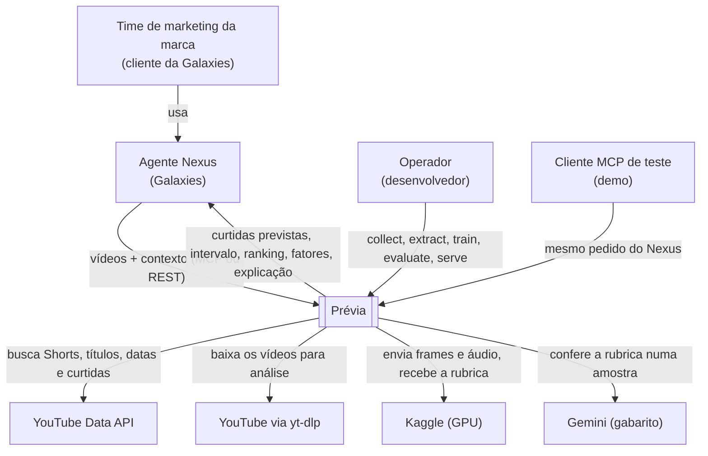
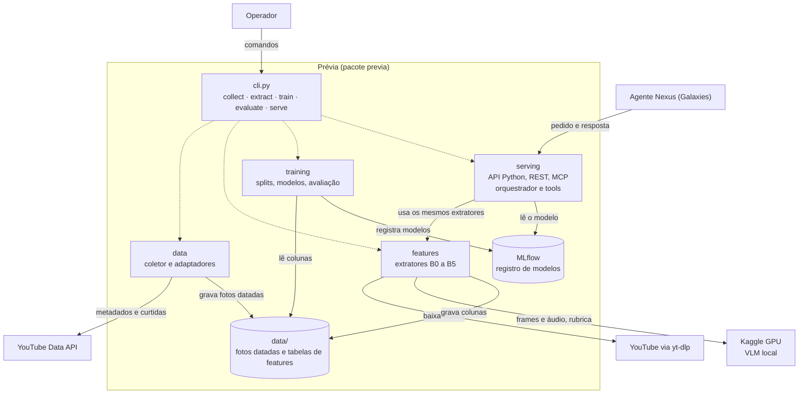
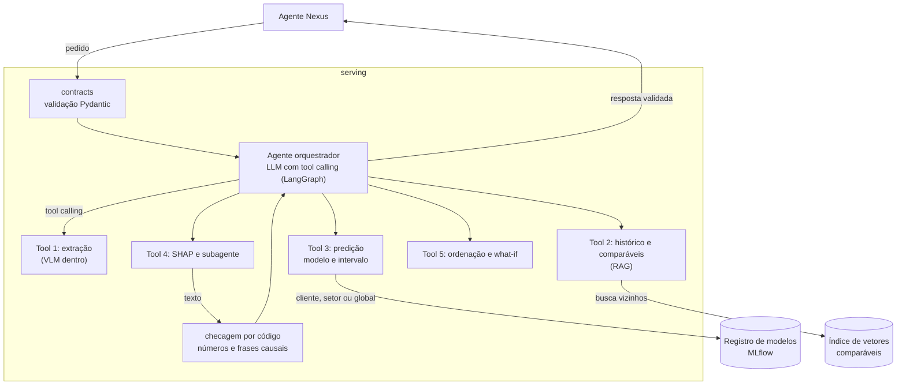

> **Arquivado em 30/09/2026.** O projeto passou a seguir o material da liga
> (https://inteliacademyclub.github.io/autoestudos/). Este documento registra o desenho anterior (24 a 27/09) e
> serve só para consulta. A referência atual está no `CLAUDE.md`.

# Prévia: especificação do projeto

| | |
|---|---|
| Sistema | **Prévia** (pacote, comandos de terminal e repositório `previa`) |
| Case | Academy x Galaxies (Inteli). Escopo oficial: o TAPI, em `escopo_projeto.md` |
| Status | Design aprovado em 27/09/2026; implementação ainda não iniciada |
| Entrega | Apresentação em 23/10/2026, preferencialmente online |
| Autor | Vinicius, com o Claude Code |
| Guia de estudos | https://claude.ai/code/artifact/6c521270-266b-4812-9a75-877ffffeee62 |

Este documento é a especificação viva do projeto. As regras de trabalho do Claude Code estão no `CLAUDE.md`.
Hipóteses aparecem marcadas como hipóteses; o restante é decisão tomada.

---

## 1. Problema

O Prévia estima, antes da publicação, quantas curtidas um YouTube Short terá num canal, com margem de erro honesta
e o porquê.

- **Hoje:** a Galaxies cria personas sintéticas (plataforma Nexus) que assistem aos criativos e opinam: "gostei
  disso, não gostei daquilo", com nota de 0 a 5. É uma opinião, e depois não há como conferir se estava certa.
- **Com o Prévia:** cada criativo ganha também um número verificável. Depois da publicação, a plataforma mostra as
  curtidas reais e o erro pode ser medido. É o "componente estatístico" que o TAPI pede.
- **Ideia central:** aprender com o passado. Publicações já feitas (vídeo + contexto) viram colunas, um modelo
  aprende a relação entre colunas e curtidas, e um criativo novo passa pelas mesmas colunas.

**O que torna o problema difícil**

- **O canal domina.** No vencedor do SMP Challenge 2025 (MVP), tirar o perfil do usuário fez o erro (MAPE) subir de
  0,175 para 0,301; tirar o embedding de vídeo, só para 0,182.
- **A decisão da marca é entre criativos do mesmo canal.** O que importa é o efeito do conteúdo, a parte pequena
  e difícil do sinal. Por isso o alvo é relativo ao canal e a métrica principal é o acerto par a par dentro do canal.
- **A previsão é antes de publicar.** Não temos a popularidade do primeiro dia, que é o que infla os números da
  literatura (no SMTPD, o Spearman cai de 0,96 para 0,85 sem ela).

**Analogias de trabalho**

- **Laudo de imóvel:** o canal é o bairro, o criativo é a casa. A persona é o corretor que conta como é morar ali;
  o Prévia é o laudo, com número, margem e imóveis comparáveis.
- **Restaurante:** cardápio = operações; comanda = contrato de entrada; prato = contrato de saída; cozinha =
  etapas internas; maître = o LLM orquestrador, que nunca cozinha.
- **Estudar × fazer a prova:** treinar é estudar, antes; prever é fazer a prova; o histórico do canal é a cola
  permitida.

## 2. Objetivos, hipótese e critérios de sucesso

**Objetivo (TAPI §2):** prever antes da publicação as curtidas de criativos de beleza e automotivo, com um modelo
treinado e avaliado de forma independente do LLM, entregando previsão, intervalo, ranking entre criativos e
explicação dos fatores.

**Hipótese principal:** os atributos do conteúdo (texto, visual, áudio, rubrica do VLM) melhoram a ordenação de
criativos do mesmo canal além do que o histórico do canal já explica.

| Critério | Meta |
|---|---|
| Bater o baseline (média e mediana históricas do canal) em validação temporal | acerto par a par e erro em log melhores, com intervalo de confiança que não inclua empate |
| Acerto par a par dentro do canal ("acurácia" para a Galaxies) | 60 a 65%; o acaso dá 50%; sempre com intervalo de confiança |
| Cobertura do intervalo de previsão | próxima do nível nominal de 80% |
| Ganho da camada multimodal | medido por bloco, com intervalo de confiança; a literatura espera +0,02 a +0,04 no Spearman |
| Cenário cliente novo (cofre de canais) | reportado separadamente |
| Entregáveis do TAPI §10 | todos cobertos (ver §15) |

## 3. Escopo

**Núcleo, na ordem de construção**

1. Base coletada e documentada (beleza e automotivo, canais brasileiros).
2. Mediana móvel do canal como baseline; modelo híbrido com metadados e histórico.
3. Blocos de texto, visual, medidos e rubrica do VLM, com o ganho de cada bloco medido.
4. Acerto par a par e erro em log com intervalo de confiança; intervalo de previsão por quantis.
5. Comparação global × setor × só o cliente; SHAP agrupado.
6. Agente orquestrador com as 5 tools, subagente explicador, API Python, REST e MCP, incluindo o treino assíncrono.
7. Demo com cliente MCP de teste e de-para às cegas; README; registro de experimentos.

**Segunda camada (só se o M2 fechar antes do prazo):** intervalos conformais (CQR), chance calibrada de A vencer B,
teste da defasagem L, demonstração do vazamento dos inscritos, curva por número de posts, modelo de visualizações,
what-if, desempenho dos comparáveis como feature, SMTPD como prova de agnosticismo.

**Fora do escopo (TAPI §4.3):** front-end elaborado; integração real com o Nexus ou com contas de anúncios;
coleta da curva de métricas de um mesmo post (early popularity); acesso a dados internos da Galaxies; construir,
simular ou avaliar personas.

## 4. Stakeholders e fronteira com a Galaxies

**Pessoas (kickoff de 23/09):** Lucas (estratégia de IA, referência técnica), Jonathan (CTO), Beatriz (ponto
focal) e Caroline Paz (organiza a apresentação de 23/10). Dúvidas vão pelo grupo existente. A liga não montou a
base; a criação ficou com os alunos.

**O consumidor é o Agente Nexus.** O Nexus compara criativos, identifica preferências de segmento e sugere
melhorias; o Agente Nexus integra esses fluxos por linguagem natural e chama o Prévia como tool. O Knowledge Store
da Galaxies guarda histórico de interações; atualizá-lo com previsões está fora do escopo.

**Duas hierarquias em eixos diferentes**

- **Galaxies, lado da audiência:** população → segmento → persona do cliente. Responde "como esse público reage e
  por quê".
- **Prévia, lado de quem publica:** global → setor → canal do cliente. Responde "quanto esse criativo tende a
  render nesse canal, com que incerteza e com base em quê".

**Regras da fronteira**

1. Contrato primeiro e autodescritivo: unidades, nível do intervalo, `contract_version` e `model_version`
   explícitos.
2. Os números são o produto; o texto é acessório, sem psicologia de público e sem afirmar causa.
3. Nada que se confunda com a persona: sem nota de 0 a 5. Usamos curtidas previstas, posição relativa ao canal e
   faixa.
4. Primitivas fáceis de combinar: além do ranking, a chance de A render mais que B.
5. Independência: o Prévia nunca treina com saída de persona e só é avaliado contra métricas reais.
6. Sem estado e reproduzível; degradação explícita quando algo falha.

## 5. Premissas e restrições

- **Entrega individual** (premissa). A base pode ser compartilhada com a turma (D2).
- **Custo zero.** O plano Edu da Gemini não dá cota de API; os planos Google AI Pro também não.
- **Hardware:** Mac M4 com 16 GB de RAM e 56 GB livres; notebook extra (especificações a confirmar); GPU T4 grátis
  do Kaggle (~30 h por semana).
- **Tempo:** semana de prova do usuário de 26/09 a 02/10 (~1 h/dia); depois, ~4 a 6 h/dia, das quais ~1 h de
  estudo.
- **Conformidade:** políticas da API do YouTube (estatísticas por até 30 dias; proibido armazenar o audiovisual;
  restrição a métricas derivadas). Uso acadêmico declarado no data card; mídia nunca versionada.
- **Premissas sobre a Galaxies, até a resposta do grupo (§16):** o `channel_id` vem na chamada; o consumo é por MCP
  e REST; "acurácia" significa acerto par a par; "série temporal" significa o histórico de posts do canal.

## 6. Arquitetura

> Se estiver estudando, faça antes os exercícios de desenho do guia de estudos (parte A8).

### 6.1 Contexto (C4, nível 1)

Em cima ficam quem usa o Prévia; embaixo, aquilo de que ele depende. O time de marketing nunca fala direto com o
Prévia, e o YouTube aparece duas vezes porque números e arquivos de vídeo chegam por portas diferentes.

### 6.2 Containers (C4, nível 2)

O serving usa os mesmos extratores do treino (paridade) e só lê modelos do registro; quem escreve no registro é o
treino.

### 6.3 Componentes do serving (C4, nível 3)

O LLM decide **o quê** (quais tools chamar e como juntar o resultado); o código garante **o como**. Só a Tool 3
produz o número.

### 6.4 Por que um pacote único em módulos (D10)

- **Train/serve skew:** existe uma única implementação de cada feature, usada no treino e no serving.
- **Agnosticismo:** retreinar em outra base com o esquema mínimo é rodar os mesmos comandos.
- **Testes de vazamento** ficam naturais, e o Kaggle roda o mesmo pacote.
- **Fronteiras claras** permitem virar serviços separados depois.
- **Custo:** dependências pesadas num só projeto, resolvido com grupos de dependências opcionais.

### 6.5 Evolução para produção (recomendação à Galaxies)

| Módulo hoje | Serviço em produção |
|---|---|
| `data` | coleta agendada dos posts novos dos clientes |
| `features` | extração em fila com GPU compartilhada e cache de features por vídeo |
| `training` | retreino agendado e modelos por cliente sob demanda, com registro de versões |
| `serving` | API e servidor MCP hospedados, escalando separados da GPU |

O maior valor em produção é o **ciclo de retorno**: depois da publicação, coletar as curtidas reais e medir o erro
por cliente, continuamente. Em produção, o VLM deve ser local ou de tier pago, por confidencialidade.

## 7. Dados e coleta

1. **Registro de canais** (`registry/channels.csv`, versionado): `channel_id`, setor, marca ou criador, país,
   quem curou e por quê.
    - Critérios: canal brasileiro; setor inequívoco (beleza ou automotivo); 30 a 50 Shorts na janela (marcas: mínimo
      de 20, se faltar volume); curtidas visíveis.
    - Meta: ~30 a 35 canais por setor, com pelo menos ~10 marcas em cada; 60 ou mais no total.
    - Candidatos gerados por lista curada e resolvidos por handle (`channels.list forHandle`, 1 unidade); validação
      automática de país, volume e inscritos; rótulo final humano.
2. **Coletor:** canal → playlist `UUSH` (troca de `UC` por `UUSH` no ID; não documentada; fallback: duração
   ≤ 180 s) → `videos.list` em lotes de 50. 15 mil vídeos custam ~600 das 10 mil unidades diárias.
3. **Janela:** publicados de 01/04/2025 até 30 dias antes da coleta. Motivos: views de Shorts redefinidas em
   31/03/2025; Shorts de até 3 minutos desde 15/10/2024; 30 dias para as curtidas estabilizarem.
4. **Fotos datadas, só acrescentadas:** cada coleta grava `collected_at` e nunca sobrescreve. Segunda foto ~14 dias
   depois para medir estabilização. Não é early popularity e não vira feature.
5. **Mídia em fluxo contínuo:** yt-dlp em 360p, um vídeo por vez, com pausas, do IP de casa; ~8 frames (2 ou 3 nos
   primeiros 3 s) e áudio comprimido; o MP4 é apagado. Cache fora do git (~3 a 4 GB para 10 mil vídeos), apagado
   no fim do projeto.
6. **Esquema canônico** = esquema mínimo do TAPI §7 (`post_id`, `channel_id`, `published_at`, `caption`,
   `media_ref`, `metric_target`, `channel_stats_at_collection`, `sector`) + extensões (`platform`, `channel_type`,
   `collected_at`, idioma, duração). Cada fonte tem um adaptador: YouTube hoje; SMTPD como prova de agnosticismo;
   base de cliente, Instagram e TikTok depois.
7. **Cofre de canais**, separado desde o dia 1 e com marcas: nunca olhado no desenvolvimento; cenário "cliente
   novo" e base da demo.
8. **Data card** no modelo *Datasheets for Datasets*: origem, período, volume, políticas de uso e o que a base não
   representa (só Brasil; só canais públicos; viés de sobrevivência; inscritos arredondados e atuais; vídeos com
   curtidas ocultas excluídos, com a taxa medida).
9. **"O alvo tem relógio":** a idade na coleta varia de 1 a 17 meses. Se a segunda foto mostrar crescimento
   relevante, a idade entra como controle no treino, com um valor de referência fixo na previsão (hipótese).

## 8. Extração de atributos

### 8.1 Blocos

Cada bloco é uma tabela separada, com chave `video_id` + `extractor@version`: cache, reprocessamento seguro e
ablação por bloco.

| Bloco | O que mede | Com quê | Onde roda |
|---|---|---|---|
| B0 Metadados | momento, legenda, formato, tipo de canal | API, ffprobe, código | Mac |
| B1 Histórico do canal | curtidas típicas, tendência, frequência, nº de posts anteriores | só posts anteriores, com defasagem L | Mac |
| B2 Texto | significado da legenda e da fala | sentence-transformers multilíngue, Whisper | Mac |
| B3 Visual | aparência do gancho e do vídeo inteiro | SigLIP 2 | Mac |
| B4 Medidos | cortes, cor, movimento, rosto, texto na tela, áudio, fala | PySceneDetect, OpenCV, MediaPipe, OCR leve, librosa, Whisper | Mac |
| B5 Rubrica | gancho, produto, antes/depois, chamada para ação, qualidade e campos por setor | VLM local de versão fixa | Kaggle |

### 8.2 Regras

- **A extração não aprende nada com a base.** PCA, K-Means dos descritores e escalas moram no treino, ajustados só
  com dados de treino e salvos junto do modelo.
- **Paridade:** frames amostrados do mesmo jeito no treino e na previsão. A thumbnail não é coluna padrão, porque
  um criativo não publicado não tem thumbnail do YouTube; entra só se o cliente enviar uma capa.
- **Manifesto de extração:** sucesso ou tipo de erro por vídeo e por bloco. Blocos ausentes seguem como valores
  ausentes, que o LightGBM trata nativamente.
- **Fora:** inscritos atuais no modelo principal (vazamento; só no baseline de regressão linear); YOLO (licença
  AGPL; o VLM cobre produto e carro em cena); curtidas e views do próprio vídeo.

### 8.3 Rubrica do VLM

- **Formato:** JSON fixo validado com Pydantic, temperatura 0, nova tentativa quando inválido.
- **Núcleo:** gancho nos primeiros 3 s (descrição e força de 0 a 10), rosto, produto em destaque, antes/depois,
  demonstração, texto na tela e densidade, ritmo de cortes, energia da música, tom da narração, **chamada para
  ação**, **qualidade de produção**, brilho e saturação, cor dominante, estética, clareza do benefício, 5 elementos
  de vídeo e 5 de áudio.
- **Extensão beleza:** swatch, aplicação na pele, resultado antes/depois. **Extensão automotivo:** close do carro,
  som do motor, direção em primeira pessoa, interior.
- **Descritores livres** (os 5 elementos) viram embeddings e depois temas por K-Means, ajustado só no treino.
- **Confiabilidade:** teste-reteste em ~100 vídeos; concordância com a Gemini numa amostra estratificada de ~300. Um
  campo com baixa concordância sai do modelo.
- **"Potencial viral 0 a 10":** é o LLM chutando o alvo. Nunca aparece como evidência na explicação; sozinho, é o
  baseline "LLM sem modelo".

### 8.4 VLM (D15)

VLM local com versão fixa: Gemma 4 E4B ou Qwen3-VL-4B, escolhido no piloto. Mesmo runtime, quantização, prompt e
amostragem de frames no treino e na previsão. Roda na GPU T4 do Kaggle (ou no notebook extra, se tiver GPU NVIDIA),
com frames e áudio enviados do Mac. A Gemini (free tier) só serve de gabarito na amostra. O provedor de VLM é
plugável. Em produção, criativos não publicados nunca vão para um free tier.

### 8.5 Dicionário de features v0

Linha = publicação (vídeo + contexto). Origem na previsão: **[contexto]** informado por quem pede; **[vídeo]**
extraído do arquivo; **[busca]** buscado pelo Prévia a partir do canal. No treino, o que é [contexto] vem da API.

| Bloco | Coluna | Origem na previsão | Com quê |
|---|---|---|---|
| B0 | dia da semana, hora (Brasília) | contexto: data prevista | código |
| B0 | tamanho do título, hashtags, emojis, pergunta, idioma | contexto: legenda | código |
| B0 | duração, proporção da tela | vídeo | ffprobe (mesma medição nos dois momentos) |
| B0 | tipo de canal (marca ou criador) | busca: registro | código |
| B1 | curtidas típicas dos últimos 10 e 30 posts | busca | posts anteriores com defasagem L |
| B1 | tendência e variação das curtidas | busca | idem |
| B1 | frequência de postagem, dias desde o último post | busca | idem |
| B1 | número de posts anteriores | busca | idem |
| B2 | embedding da legenda | contexto | sentence-transformers |
| B2 | embedding da fala transcrita | vídeo | Whisper + sentence-transformers |
| B3 | embedding dos frames do gancho (0 a 3 s) | vídeo | SigLIP 2 |
| B3 | embedding do vídeo inteiro | vídeo | SigLIP 2 |
| B4 | cortes e cortes por segundo | vídeo | PySceneDetect |
| B4 | brilho, contraste, saturação, cor dominante, movimento | vídeo | OpenCV |
| B4 | rosto: presença, quantidade, tamanho | vídeo | MediaPipe |
| B4 | texto na tela | vídeo | OCR leve |
| B4 | energia do áudio, batidas, música ou fala | vídeo | librosa |
| B4 | palavras, palavras por segundo, idioma da fala | vídeo | Whisper |
| B5 | núcleo da rubrica (§8.3) | vídeo | VLM local |
| B5 | extensões de beleza e automotivo | vídeo | VLM local |
| Alvo | curtidas, em log, relativas ao canal | só existe no treino | API do YouTube |

Na implementação, este dicionário vira `docs/feature_dictionary.md`, com definição e momento de disponibilidade de
cada coluna.

## 9. Modelagem e avaliação

- **Alvo (D8):** log(1 + curtidas), relativo ao nível point-in-time do canal. Visualizações passam pelo mesmo
  pipeline como resultado secundário (camada 2).
- **Famílias de modelo** (pedido do kickoff: série temporal × regressão):
    - série temporal do canal: último post, mediana móvel, suavização exponencial;
    - regressão: LightGBM com todos os blocos;
    - **híbrido (aposta principal):** LightGBM prevê o desvio do criativo em relação à mediana móvel do canal.
- **Baselines:** média e mediana históricas do canal (mínimo do TAPI); regressão linear sobre inscritos (com a
  ressalva de vazamento); LLM sozinho (potencial viral).
- **Combinar clientes (D4, pedido do kickoff):** para canais com volume, só o cliente × setor × global × global com
  ajuste do cliente. Nome na literatura: modelos locais × globais.
- **Validação:**
    - split temporal: treino de abr/2025 a jan/2026, calibração de fev a abr/2026, teste de mai a ago/2026 (datas
      provisórias; as finais saem da análise exploratória);
    - hiperparâmetros escolhidos só dentro do treino, com validação temporal interna;
    - cofre de canais como cenário "cliente novo";
    - defasagem mínima L no histórico (teste de L = 0, 7 e 30 dias na camada 2).
- **Métricas:**

| Métrica | Leitura |
|---|---|
| Acerto par a par dentro do canal (pares com até 30 dias entre si) | métrica principal; acaso = 50%; meta 60 a 65% |
| Acerto acima ou abaixo da mediana do canal | acaso = 50% |
| Spearman dentro do canal | ordenação por canal |
| Spearman global | reportado como inflado pelo tamanho do canal |
| MAE em log e fator de erro | "erra, em média, por um fator de X" |
| MAPE no log | comparável ao SMP Challenge |
| F1 nas faixas (abaixo, na média, acima, viral) | comunicação do resultado |
| Cobertura e largura do intervalo | cobertura próxima de 80% |

- **Incerteza:** todas as métricas com intervalo de confiança por bootstrap por canal; ganhos de ablação com
  bootstrap pareado. Intervalo de previsão por quantis do LightGBM (10%, 50%, 90%). Na camada 2, CQR (MAPIE) no
  período de calibração e chance calibrada de A vencer B (avaliada pelo Brier score).
- **Sinal de confiança** sempre com motivos: poucos posts do canal, criativo fora da distribuição, intervalo largo,
  falha de extração, modalidade parcial.
- **Explicabilidade:** SHAP (TreeSHAP) agrupado por família (gancho, áudio, estilo visual, histórico do canal).
  Mostra associação, não causa.
- **Registro:** todos os experimentos no MLflow, com a versão da base e dos extratores. Análise de erros por setor,
  tipo de canal, duração e cauda viral.

## 10. Serving: API, agente e MCP

### 10.1 Operações

Cada operação existe como função Python documentada (`previa.*`), endpoint REST (FastAPI) e tool MCP (FastMCP),
todas sobre a mesma camada de serviço.

| Operação | Recebe | Devolve |
|---|---|---|
| `rank_creatives` (principal) | lote de criativos de um cliente + contexto | previsão de cada um, ranking, chance de cada par |
| `predict_creative` | um criativo + contexto | previsão completa |
| `start_training` | base no esquema mínimo, escopo (cliente, setor ou global), métrica | `job_id` imediato |
| `get_training_status` | `job_id` | andamento; no fim, métricas e `model_id` |
| `list_models` | nada | modelos disponíveis, escopo e métricas |
| `what_if` (camada 2) | criativo + variações de legenda, horário ou gancho | previsão de cada variação |
| entrada em linguagem natural | pergunta livre | resposta do agente orquestrador |

`rank_creatives` é síncrono, com limite de tamanho de lote e avisos de progresso. O treino é assíncrono: toda chamada
de rede tem tempo limite, e o que pode passar de ~1 minuto vira tarefa em segundo plano.

### 10.2 Contrato de entrada

| Campo | Obrigatório | Observação |
|---|---|---|
| criativo | sim | arquivo, link ou asset armazenado; vídeo, imagem ou texto (imagem e texto com aviso e baixa confiança) |
| `channel_id` | sim, ou a alternativa abaixo | usado para buscar o histórico |
| `channel_stats` + histórico enviado | alternativa | canal sem histórico público |
| `sector` | sim | beleza ou automotivo |
| legenda planejada | sim, pode ser vazia | título, descrição, hashtags |
| data e hora previstas | sim | fuso de Brasília |
| `metric` | não (padrão: curtidas) | curtidas ou visualizações |
| `platform` | não (padrão: YouTube) | preparado para outras plataformas |
| capa | não | só se o cliente tiver |
| `explain`, incluir atributos | não | liga ou desliga o texto do LLM e a lista de atributos |

### 10.3 Contrato de saída (por criativo)

`predicted_metric`, `interval_low`, `interval_high` e nível nominal; `relative_to_channel` e faixa;
`confidence_flag` com motivos; `top_drivers` (SHAP agrupado, com sentido do efeito); valores dos atributos
interpretáveis (inspeção, TAPI §7); `explanation` (opcional); `comparables`; modelo usado (escopo, número de posts do
cliente, `model_version`); status por bloco de extração; `errors`; `warnings`; `contract_version`. No lote:
ranking e matriz de chances par a par.

### 10.4 Orquestração em dois níveis (D16)

- **Agente orquestrador** (LangGraph, LLM com tool calling em laço ReAct com guardrails): interpreta o pedido,
  escolhe as tools, confere resultados e redige a resposta.
- **Tools determinísticas** (as 5 do diagrama do TAPI): garantem o como. O LLM só aparece dentro da extração (VLM,
  como instrumento de medida) e da explicação (subagente).
- **`rank_creatives` é um fluxo fixo:** validar, buscar mídia, extrair, histórico e comparáveis, escolher modelo,
  prever, SHAP, ordenar e calcular chances, explicação opcional, resposta. Os passos por criativo rodam em paralelo.
- **Quando usar LLM** (quatro perguntas): o conteúdo é não estruturado? existe método determinístico? o resultado é
  um número que alimenta decisão? um erro plausível seria difícil de detectar? O número nunca vem de LLM, o que
  também protege contra prompt injection.

### 10.5 Tool 2: histórico e comparáveis (RAG)

- **Histórico, por tempo:** últimos posts do canal com curtidas reais; dão o normal do canal e a tendência.
- **Comparáveis, por semelhança:** vetor de cada vídeo (visual + texto + descritores da rubrica); busca exata por
  cosseno em numpy (~10 mil vetores); primeiro o mesmo canal, depois o setor; só vídeos publicados antes da data
  planejada. Devolve link, data, curtidas reais, desempenho relativo ao canal, similaridade e atributos em comum.
- **Camada 2:** o desempenho dos vizinhos vira feature (retrieval-augmented prediction, como no MMRA).

### 10.6 Tool 4: SHAP e subagente explicador

O subagente recebe só dados estruturados e escreve de 3 a 5 frases no formato "deve render X por causa de A, B e C;
puxa para baixo D". Regras: citar só a evidência recebida, sem causa, sem psicologia de público. Depois, o código
confere que todo número citado existe na entrada e barra frases causais; se falhar, uma nova tentativa; se falhar
de novo, a resposta sai sem texto e com aviso.

### 10.7 Ciclo de vida dos modelos (D18)

- **Antes (offline):** treinamos o global, o de beleza, o de automotivo e modelos de cliente para canais com
  volume. Cada um é salvo com as transformações ajustadas e os quantis, e registrado no MLflow.
- **Pedido de previsão:** nada é treinado. A ordem é cliente → setor → global, escolhendo o mais específico que
  provou ser melhor na validação.
- **Ajuste do cliente na hora:** nível relativo ao canal + correção de viés com shrinkage (por exemplo, peso
  n/(n + k), com k a calibrar; hipótese).
- **Pedido de treino:** tarefa em segundo plano que baixa, extrai, treina e valida no tempo. O **portão de
  promoção** só aceita o modelo novo se ele ganhar do atual.
- **Cliente novo fora da base:** modelo do setor + histórico público + ajuste; sem canal público, envia o histórico
  ou pede treino.

### 10.8 Falhas e segurança

Cada criativo falha sozinho, sem derrubar o lote. VLM fora do ar: previsão sem o bloco B5, com aviso. LLM da
explicação fora do ar: números sem texto, com aviso. Canal sem histórico: referência do setor e baixa confiança.
Tentativas sempre com limite. Legenda, texto na tela e fala entram como dado, nunca como instrução.

### 10.9 Avaliações do agente

Um conjunto de ~15 a 20 pedidos de teste, com as tools esperadas e checagens: números batem com as tools, sem
afirmações causais, sem comparáveis inventados. O subagente tem avaliação de fidelidade própria.

### 10.10 Demo

Um cliente MCP genérico (MCP Inspector ou Claude Desktop) faz o papel do Nexus. A demo mostra o processamento
(frames do gancho, trecho da transcrição, respostas da rubrica, fatores) e o de-para às cegas com canais do cofre e um
lançamento real de marca brasileira. Um notebook com Plotly apoia; Gradio é opcional.

## 11. Engenharia

- **Estrutura do repositório, convenções, comandos e armadilhas:** ver `CLAUDE.md`.
- **Ferramentas:** Python 3.12 via uv (D12); ruff; pytest; MLflow local; yt-dlp como dependência Python; ffmpeg via
  Homebrew; GitHub privado (D13), com o Kaggle instalando o pacote por token.
- **Testes:** vazamento (os mais importantes), unitários com TDD para dados, features e métricas, contratos, golden
  tests de extratores, avaliações do agente e do subagente à parte.
- **Reprodutibilidade:** código no git, ambiente no `uv.lock`, dados em fotos datadas, extratores versionados,
  modelos e métricas no MLflow, parâmetros em YAML, seeds fixas. Meta: um comando refaz qualquer resultado.
- **Segredos:** `.env` fora do git, documentado em `.env.example`.
- **Fluxo de trabalho:** teach-back do usuário → encanamento pelo Claude Code → `TODO(human)` nas decisões de design
  → testes antes do merge. Modo Explanatory na semana de prova; Learning depois.

## 12. Cronograma

| Período | Foco | Entregas | Marco |
|---|---|---|---|
| 24 a 27/09 | Fundação | design aprovado; `CLAUDE.md`, `PROJECT.md` e guia de estudos | |
| 26/09 a 02/10 (prova) | Trabalho de máquina | repositório e ambiente; coletor e extratores; lista de canais com validação automática e revisão de rótulos (~1 h); primeira coleta; piloto de 50 vídeos; extração noturna e VLM no Kaggle | **M0 (02/10):** base e extração rodando sozinhas |
| 03 a 07/10 | Coração de ML | B0 e B1 com testes de vazamento; split; baseline; híbrido v0; acerto par a par; `predict_creative` + MCP mínimo | **M1 (07/10):** esqueleto ponta a ponta |
| 08 a 13/10 | Multimodal e experimentos | blocos B2 a B5 integrados; ablação; pooling; quantis; segunda foto | **M2 (13/10):** modelo completo, ganho por bloco medido |
| 14 a 18/10 | Agente e integração | orquestrador, subagente, comparáveis, REST e MCP, treino assíncrono, avaliações do agente | **M3 (18/10):** congelamento |
| 19 a 23/10 | Prova e apresentação | de-para às cegas; análise de erros; README com as seções do TAPI; ensaio | apresentação em 23/10 |

## 13. Riscos

| Risco | Mitigação |
|---|---|
| YouTube bloqueia o download (yt-dlp) | IP de casa, cookies, ritmo lento; em último caso, thumbnail + Gemini por link numa amostra |
| Poucas marcas brasileiras com Shorts suficientes | relaxar o mínimo para marcas (20 Shorts); base compartilhada com a liga |
| VLM no Kaggle lento demais | piloto de 50 vídeos antes; menos frames ou amostra |
| Ganho multimodal pequeno | esperado pela literatura; reportar com intervalo de confiança |
| Acerto abaixo de 60% | reportar com honestidade e análise de erros; a arquitetura também é entrega |
| Escopo maior que o tempo | esqueleto primeiro; camada 2 só após o M2; congelamento em 18/10 |
| Mudança de API ou de cota | cache, fotos datadas e versões fixas |
| Conformidade com as políticas do YouTube | data card, mídia fora do git, cache apagado no fim |
| Requisitos ambíguos da Galaxies | perguntas ao grupo (§16); premissas escritas (§5) |
| Hardware (16 GB de RAM, 56 GB de disco) | mídia em fluxo contínuo; GPU do Kaggle |

## 14. Registro de decisões

Formato: decisão · contexto e motivo · alternativas descartadas · consequência.

- **D1 · Base de dados (24/09).** A liga não montou a base; a coleta fica conosco. Alternativa: esperar a liga.
  Consequência: coleta vira subsistema de primeira classe e a curadoria de canais é o passo crítico.
- **D2 · Colaboração "solo primeiro, pronto para compartilhar" (24/09).** Coletar sozinho já, num formato que a
  turma possa adotar: registro de canais e metadados compartilháveis (`collected_by`, `collected_at`); features
  opcionais; modelo e agente individuais. Alternativas: base só compartilhada (dependência no caminho crítico) ou só
  individual (menos canais). Consequência: proposta de uma página à liga.
- **D3 · Mercado: Brasil primeiro (24/09).** Coerente com o TAPI (BERTimbau, embeddings multilíngues) e com clientes
  locais. Alternativas: global ou misto. Consequência: rubrica e explicações em português; idioma registrado.
- **D4 · Especialização em camadas do lado de quem publica (24/09).** Alvo relativo ao canal, ajuste do cliente com
  shrinkage, comparáveis do próprio canal, cadeia cliente → setor → global. Confirmado no kickoff. Alternativas: um
  modelo por cliente (pouco dado, sem resposta para cliente novo) ou só global/setor (perde a especialização).
- **D5 · Fronteira com a Galaxies (24/09).** Duas hierarquias em eixos diferentes e as regras da §4. Consequência:
  Knowledge Store e leitura de público ficam fora; sem nota de 0 a 5.
- **D6 · Modo de trabalho Learning (24/09).** Aprender é o objetivo nº 1. Consequência: teach-back e `TODO(human)`;
  Explanatory na semana de prova.
- **D7 · Setores: beleza e automotivo (24/09).** Moda e beleza se misturam em canais brasileiros (ruído de rótulo);
  o contraste torna informativo o experimento de especialista. Alternativas: beleza + moda, moda + automotivo, os
  três.
- **D8 · Alvo: curtidas (24/09).** Views de Shorts medem distribuição do algoritmo desde 31/03/2025; curtida é ação
  deliberada. Consequência: views como resultado secundário com o mesmo pipeline.
- **D9 · Custo zero (24/09).** Plano Edu sem cota de API. Consequência: VLM local; Gemini só como gabarito.
- **D10 · Pacote Python único em módulos (24/09).** Ver §6.4. Alternativas: serviços separados (infraestrutura
  demais) ou notebooks primeiro (train/serve skew).
- **D11 · Idioma (24/09).** Código, comentários e commits em inglês; documentação em português.
- **D12 · Ambiente com uv e Python 3.12 (24/09).** Lockfile reproduzível. Alternativa: conda.
- **D13 · Repositório privado no GitHub (24/09).** Alternativas: público desde já ou só local.
- **D14 · Nome: Prévia, pacote `previa` (24/09).** Alternativas: Laudo, `creative_forecast`.
- **D15 · VLM local com versão fixa; Gemini como gabarito (24/09).** Custo zero, sem cota, paridade e
  confidencialidade. Alternativa: Gemini como extrator principal (cota de ~500 pedidos/dia e dados usados para
  treino).
- **D16 · Orquestração em dois níveis (24/09).** O TAPI pede o LLM orquestrando; o número continua vindo das tools.
  Alternativa descartada: fluxo 100% fixo (não atende ao TAPI §7).
- **D17 · Treino como endpoint do núcleo, assíncrono, com REST e MCP (24/09).** Pedido do kickoff: endpoints
  separados de treino e predição. Consequência: `start_training`, `get_training_status`, portão de promoção.
- **D18 · Ciclo de vida dos modelos (25/09).** Nada é treinado no pedido de previsão; registro de modelos com cadeia
  e portão de promoção.

**Divergências justificadas em relação ao TAPI**

- SMTPD não serve de bootstrap na semana 1 (vídeo longo, outro alvo); vira prova de agnosticismo.
- A thumbnail não é feature padrão (paridade com criativos não publicados).
- YOLO fica fora (licença AGPL); o VLM cobre produto e carro em cena.
- A Gemini é gabarito, não extrator principal (D15).
- Inscritos são coletados, mas ficam fora do modelo principal (vazamento).
- O treino dinâmico sobe de extensão para o núcleo (D17).
- Conformal, what-if, visualizações e curva por número de posts ficam na camada 2 (tempo).
- A segunda foto das estatísticas não é early popularity e não vira feature.

## 15. Rastreabilidade do TAPI

| Requisito do TAPI | Onde está no Prévia | Status |
|---|---|---|
| §2 Base coletada, documentada e criticada via YouTube Data API | §7 | Coberto |
| §2 Modelo tabular com baseline declarado e validação temporal | §9 | Coberto |
| §2 Atributos multimodais gratuitos e ganho sobre metadados e texto | §8, §9 (ablação) | Coberto |
| §2 Agente que devolve previsão, intervalo, ranking e justificativa | §10 | Coberto |
| §2 Ferramenta integrável (função/API e MCP), agnóstica à base | §7 (esquema), §10.1 | Coberto |
| §4.1 Base documentada (origem, período, volume, licença, setores, limites) | §7 (data card) | Coberto |
| §4.1 Opção A com GBM e baseline = média histórica do canal | §9 | Coberto |
| §4.1 Multimodal leve: frames, Whisper, 5 a 8 atributos por VLM (incl. chamada para ação e qualidade de produção) | §8 | Coberto (thumbnail: divergência justificada) |
| §4.1 Validação temporal, split por canal, MAE e MAPE em log, Spearman, par a par, análise de erros | §9 | Coberto |
| §4.1 Intervalo por quantis do GBM e sinal de baixa confiança | §9 | Coberto |
| §4.1 Agente em LangGraph com tools de extração, histórico/comparáveis, predição, explicabilidade e ordenação | §10.4 | Coberto (D16) |
| §4.1 Função Python documentada + servidor MCP + demo | §10.1, §10.10 | Coberto |
| §4.1 README e registro de experimentos | §9 (MLflow), §12 | Coberto |
| §4.2 Treinamento dinâmico | §10.1, §10.7 | Coberto no núcleo (D17) |
| §4.2 Conformal | §9 | Camada 2 |
| §4.2 RAG sobre comparáveis | §10.5 | Núcleo como evidência; camada 2 como feature |
| §4.2 What-if | §10.1 | Camada 2 |
| §4.2 LLM zero-shot × modelo treinado | §8.3, §9 | Coberto (baseline "LLM sem modelo") |
| §4.2 Embeddings de vídeo completo e de áudio | — | Fora (opcional no TAPI) |
| §6.1 Alvo relativo ao canal; faixas como alvo secundário | §9 | Coberto |
| §6.1 Baselines: média/mediana do canal e regressão sobre inscritos | §9 | Coberto |
| §6.1 Regras de vazamento | §8.2, §9, `CLAUDE.md` | Coberto (reforçado com defasagem L) |
| §6.2 Pipeline cacheado por `video_id` | §7, §8.1 | Coberto |
| §6.2 Rubrica JSON, adaptação por setor, clusterização de descritores | §8.3 | Coberto |
| §6.4 Armadilhas (yt-dlp, T4, cotas da Gemini, PCA, log) | `CLAUDE.md` | Coberto |
| §7 Inspeção: atributos, previsão e evidência visíveis | §10.3 | Coberto |
| §7 Contrato de entrada (criativo vídeo/imagem/texto, `channel_id` ou `channel_stats`) | §10.2 | Coberto |
| §7 Contrato de saída | §10.3 | Coberto |
| §7 Esquema mínimo para retreino; Pydantic | §7, §10 | Coberto |
| §10 Entregáveis: agente, modelo, experimento, demo, README | §3, §12 | Coberto |

## 16. Perguntas em aberto e hipóteses a validar

**Perguntas ao grupo da Galaxies**

1. "Acurácia de 60 a 65%" é acerto par a par entre criativos, acerto de "acima ou abaixo do normal do canal", ou
   outra métrica?
2. "Série temporal" quer dizer o histórico de posts do canal ou a curva de desempenho de cada vídeo?
3. Os endpoints devem ser REST, MCP ou os dois? Rodando local ou hospedados?
4. Querem curtidas e visualizações como saídas?
5. Onde ficam os "conteúdos previamente armazenados"?
6. O `channel_id` do cliente estará disponível na chamada?

**Hipóteses a validar com dados**

- Datas finais da janela e do split (após a análise exploratória).
- Número de canais e de marcas brasileiras viáveis por setor; taxa de vídeos com curtidas ocultas.
- Estabilização das curtidas após 30 dias (segunda foto) e necessidade do controle por idade.
- Valor da defasagem L.
- Vazão real de download, extração e VLM (piloto de 50 vídeos); escolha entre Gemma 4 E4B e Qwen3-VL-4B.
- Especificações do notebook extra (GPU NVIDIA?).
- Funcionamento da playlist `UUSH` para todos os canais.
- Especialista de setor × global; tamanho do ganho multimodal; valor de k no shrinkage.

## 17. Referências

- **Papers do projeto:** [Understanding Virality](https://arxiv.org/abs/2512.21402) ·
  [MVP, SMP Challenge 2025](https://arxiv.org/abs/2507.00950) · [HyperFusion](https://arxiv.org/abs/2507.00926) ·
  [SMTPD](https://arxiv.org/abs/2503.04446) · [MicroLens](https://github.com/westlake-repl/MicroLens) ·
  [MMRA](https://github.com/ICDM-UESTC/MMRA) · [SMP Challenge](https://github.com/social-media-prediction/SMPChallenge)
- **Método:** [Kapoor e Narayanan, vazamento](https://arxiv.org/abs/2207.07048) ·
  [Montero-Manso e Hyndman, modelos locais × globais](https://arxiv.org/abs/2008.00444) ·
  [Angelopoulos e Bates, predição conformal](https://arxiv.org/abs/2107.07511) ·
  [Datasheets for Datasets](https://arxiv.org/abs/1803.09010) ·
  [FPP3, validação em séries temporais](https://otexts.com/fpp3/tscv.html)
- **Plataforma:** [custos de cota da YouTube Data API](https://developers.google.com/youtube/v3/determine_quota_cost) ·
  [políticas da API do YouTube](https://developers.google.com/youtube/terms/developer-policies) ·
  [vídeo na Gemini API](https://ai.google.dev/gemini-api/docs/video-understanding)
- **Stack:** [LangGraph](https://pypi.org/project/langgraph/) · [FastMCP](https://gofastmcp.com) ·
  [MAPIE](https://mapie.readthedocs.io) · [SHAP no livro de Molnar](https://christophm.github.io/interpretable-ml-book/shap.html) ·
  [MLflow](https://mlflow.org/docs/latest/ml/tracking/quickstart/) ·
  [Building Effective AI Agents](https://www.anthropic.com/engineering/building-effective-agents) ·
  [C4 model](https://c4model.com/)
