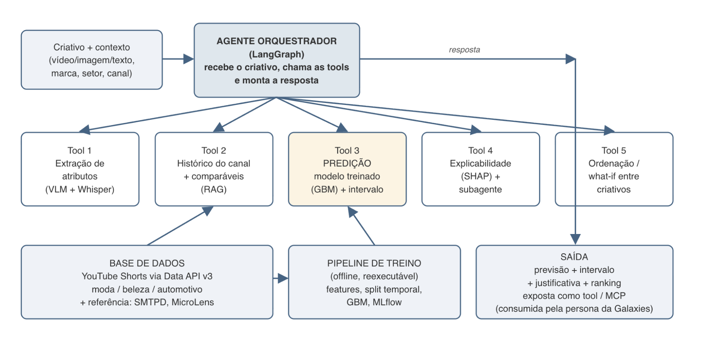

# Agente Preditivo de Performance em Mídias Sociais

Academy x Galaxies

<!-- Página 1 -->

## 1. Contexto e justificativa

A Galaxies constrói personas sintéticas: modelos que simulam segmentos reais de consumidores e respondem no lugar deles em pesquisa de mercado. Hoje, quando um time de marketing envia cinco vídeos de campanha, as personas assistem, comentam ('gostei disso, não gostei daquilo') e dão uma nota de 0 a 5. Esse feedback é qualitativo e inferencial: não há nenhum componente estatístico por trás, e não existe número real para comparar.

Existe um caso em que o número real existe: performance de conteúdo em plataforma de mídia. A marca publica um criativo e a plataforma devolve curtidas, visualizações, comentários e compartilhamentos. Se um modelo estimar esse número antes da publicação, o erro pode ser medido depois. Uma persona que acerta qual de dois criativos vai render mais muda a decisão de mídia antes de qualquer verba ser gasta.

Na plataforma da Galaxies, a persona sintética já existe: ela assiste o criativo e dá uma opinião qualitativa. O que falta é o componente estatístico. Este projeto entrega exatamente essa peça: um modelo preditivo treinado sobre dados observados, embrulhado em um agente que recebe o criativo, extrai seus atributos, consulta o modelo e devolve previsão, intervalo e explicação. O resultado será consumido como tool pela persona da Galaxies; os alunos não precisam construir nem simular a persona, isso a Galaxies já faz. Para a liga, é a oportunidade de combinar machine learning clássico (tema das aulas atuais) com o domínio que os membros já têm em LLMs e agentes.

## 2. Objetivo

Construir um agente que preveja, **antes da publicação**, uma métrica de performance de um criativo (**curtidas ou visualizações**) para os setores de moda, beleza e automotivo, apoiado em um modelo preditivo treinado e avaliado de forma independente do LLM, com previsão, intervalo de confiança, ordenação entre criativos e explicação dos fatores que sustentam a previsão.

**Pergunta norteadora:** é possível prever, antes da publicação e a partir do conteúdo do criativo e do histórico do canal, como um público real vai reagir a ele, e com que margem de erro?

### Objetivos específicos

- Montar, documentar e criticar uma base de criativos e métricas coletada por rota pública (YouTube Data API v3).
- Treinar um modelo preditivo tabular sobre atributos do criativo, do canal e do contexto, com baseline declarado e validação temporal.
- Extrair atributos multimodais do criativo (visual, áudio, texto) com ferramentas gratuitas ou modelos abertos, e medir o ganho que eles trazem sobre metadados e texto.
- Embrulhar o modelo em um agente orquestrador que recebe criativo + contexto e devolve previsão, intervalo, ranking e justificativa.
- Expor o fluxo como ferramenta integrável (função/API e servidor MCP), agnóstica à base de dados, para reutilização futura pela Galaxies.

<!-- Página 2 -->

## 3. Decisões de escopo tomadas na reunião de alinhamento

| Tema | Decisão | Justificativa |
|---|---|---|
| Caso de uso | Prever performance antes de publicar | É o fluxo da Galaxies: escolher entre criativos antes da verba. Prever com métricas iniciais teria acurácia bem maior. |
| Plataforma | YouTube Shorts como fonte principal; datasets públicos (SMTPD, MicroLens) como referência. | TikTok não tem API gratuita, o scraping é frágil e viola os Termos de Serviço; a Research API acadêmica leva meses para ser aprovada. A YouTube Data API v3 é oficial, gratuita (10.000 unidades/dia) e legalmente segura. |
| Setores | Moda, beleza e automotivo. Cada aluno escolhe pelo menos dois. | Clientes mais ativos da Galaxies. |
| Multimodal | Obrigatório em versão leve: thumbnail/frames + transcrição + atributos extraídos por VLM gratuito. | Os setores são visuais; a Galaxies precisa ver o agente processando o vídeo. Ferramentas gratuitas (Gemini Flash free tier, Gemma multimodal local, CLIP, Whisper). |
| Acurácia | Sem meta mínima rígida; bater o baseline e acertar ordenação valem mais que o valor absoluto. | A Galaxies afirmou que ~60% de acerto com arquitetura correta já prova o conceito. |
| Interface | Streamlit/Gradio opcional; obrigatório expor o fluxo como tool (função + MCP). | O resultado será consumido via tool no agente da Galaxies, não por um front-end. |
| Explicabilidade e Camada de reasoning | Camada de reasoning obrigatória (SHAP + subagente que explica a previsão em linguagem natural). | Pedido explícito da Galaxies: 'acho que vai viralizar por conta disso, disso e disso'. A leitura pela ótica do público fica com a persona da Galaxies, que consumirá a tool. |
| Agnosticismo | Pipeline de treino reexecutável sobre qualquer base com esquema mínimo declarado. (opcional) | Quando um cliente liberar sua base de ads, o mesmo workflow deve treinar um modelo especialista. |

<!-- Página 3 -->

## 4. Escopo

### 4.1 Dentro do escopo (núcleo obrigatório)

- Base de dados documentada: origem, período, volume, licença, setores e o que ela não representa.
- Modelo preditivo (Opção A, metadados + texto): features do canal, temporais, do texto e embeddings; gradient boosting (LightGBM/CatBoost) ou equivalente; baseline mínimo = média histórica do canal.
- Multimodal leve (Opção B reduzida): embedding da thumbnail/frames (CLIP ou similar), transcrição (Whisper) e 5 a 8 atributos estruturados extraídos por VLM (gancho nos primeiros 3 s, rosto presente, texto na tela, produto em destaque, tom, chamada para ação, qualidade de produção). Medir o ganho sobre a Opção A. Detalhamento, ferramentas gratuitas e rubrica na seção 6.2.
- Experimento: validação temporal, split também por canal, métricas de erro (MAE em log, MAPE), métrica de ordenação (Spearman, acurácia par-a-par), análise de erros.
- Intervalo e confiança: intervalo de predição (quantis do GBM) e sinal de baixa confiança quando a evidência é fraca.
- Agente em LangGraph com tools de extração de atributos, histórico/comparáveis, predição, explicabilidade e ordenação.
- Integração: fluxo exposto como função Python documentada e como servidor MCP; demonstração executável sobre um conjunto de criativos.
- README e registro de experimentos (MLflow ou equivalente).

### 4.2 Extensões opcionais ('ir além')

- Treinamento dinâmico: tool que recebe uma nova base com o esquema mínimo e treina/avalia um modelo específico do cliente.
- Intervalos calibrados por predição conformal.
- RAG sobre criativos comparáveis de alto desempenho (retrieval-augmented prediction).
- Loop de otimização (what-if): variações de legenda, horário ou gancho re-pontuadas pelo modelo.
- Comparação LLM zero-shot vs. modelo treinado.
- Embeddings de vídeo completo (X-CLIP/VideoMAE) e de áudio (CLAP).

### 4.3 Fora do escopo

- Produto final ou front-end elaborado; integração real com a plataforma da Galaxies ou com contas de anúncios de clientes.
- Coleta de série temporal de métricas do mesmo post (early popularity), exceto via datasets públicos que já a contenham.
- Acesso a dados, pipelines ou personas internas da Galaxies.
- Construção, simulação ou avaliação de personas sintéticas ou de segmentos de público: isso já é feito pela Galaxies, que consumirá a tool entregue.

<!-- Página 4 -->

## 5. Dados

A Galaxies não fornece base nem acesso a dados de clientes. A montagem da base é responsabilidade da Inteli Academy e precisa estar disponível no kickoff, para que o aluno entregue previsão e não scraper. A coleta é feita por rota pública, o mesmo caminho que a Galaxies usa internamente.

| Fonte | Papel | Detalhes |
|---|---|---|
| YouTube Shorts (Data API v3) | Base principal, entregue pela liga | Lista curada de canais de marcas e criadores de moda, beleza e automotivo (ex.: canais oficiais de varejistas e montadoras). Coleta de vídeos com idade ≥ 30 dias (métricas estabilizadas): título, descrição, tags, duração, data/hora, categoria, inscritos, views, likes, comentários, thumbnail e URL. Meta: 5.000 a 15.000 vídeos, 60+ canais, com a data de coleta registrada. Custo de cota: usar playlists de canais (1 unidade) em vez de search (100 unidades). |
| SMTPD (CVPR 2025) | Referência e bootstrap na semana 1 | 282K vídeos do YouTube com título, descrição, tags, thumbnail, inscritos e popularidade rastreada por 30 dias. Permite treinar antes da base própria ficar pronta e testar o efeito de early popularity como experimento comparativo. |
| MicroLens-100K | Opcional, multimodal | 19.738 micro-vídeos (estilo TikTok) com vídeo bruto, capa, áudio, likes e views. Útil para quem quiser testar embeddings de vídeo completo. |
| Criativos de teste | Demonstração | Vídeos já publicados de canais fora do treino (ex.: um lançamento recente de marca do setor). Métrica real é conhecida, permitindo o 'de-para' na apresentação. |

## 6. Formulação do problema preditivo

### 6.1 Alvo, baseline, splits e métricas

| Elemento | Definição recomendada |
|---|---|
| Alvo primário | log(1 + curtidas) ou log da razão curtidas / mediana dos posts anteriores do canal (desempenho relativo ao canal). O alvo relativo isola o efeito do conteúdo, que é o que interessa à decisão entre criativos. |
| Alvo secundário | Classificação em faixas (abaixo / na média / acima / viral em relação ao canal), para comunicação do resultado. |
| Baseline mínimo | Média (ou mediana) histórica do canal; regressão linear sobre inscritos. O modelo precisa bater o baseline com validação temporal. |
| Splits | Temporal (treino no passado, teste no futuro) como principal; split por canal (canais não vistos) para medir generalização a novos clientes. Validação cruzada aleatória é proibida como métrica final. |
| Métricas | Erro absoluto e relativo em escala log (MAE, MAPE); ordenação (Spearman global e intra-canal, acurácia par-a-par entre criativos); cobertura do intervalo; F1 nas faixas. |
| Vazamento | Nunca usar views para prever likes (ou vice-versa) se a métrica não existe antes da publicação; histórico do canal só com posts anteriores ao alvo. |
| Expectativa | Literatura (SMP Challenge, SMTPD): Spearman ~0,55–0,85 antes da publicação; features do canal dominam; conteúdo visual costuma adicionar +0,02 a +0,04. Valor absoluto de curtidas é mal previsível; ranking relativo é o alvo realista. |

### 6.2 Camada multimodal (obrigatória): o que extrair e com o quê

Moda, beleza e automotivo são setores em que o conteúdo visual decide o resultado, e a Galaxies precisa ver o agente processando o vídeo. Por isso a extração de atributos visuais e de áudio faz parte do núcleo. A literatura mostra que o caminho que funciona é: encoders congelados e um VLM transformam o vídeo em colunas, e um gradient boosting faz a previsão. Foi assim que o vencedor do SMP Challenge 2025 (X-CLIP + CatBoost) e o trabalho mais próximo deste projeto, sobre 11 mil YouTube Shorts (Gemini extrai atributos, XGBoost prevê, Spearman 0,71 e 76% de acerto par a par), obtiveram seus resultados. Tudo abaixo é gratuito ou roda em Colab/Kaggle.

#### Pipeline de referência (reprodutível e cacheado)

- Download: yt-dlp baixa vídeo em 360p, thumbnail e áudio; o ID do vídeo é a chave de cache. Salvar cada etapa em disco (parquet/JSON por vídeo) e nunca reprocessar.
- Frames: ffmpeg ou decord extrai 5 a 8 frames, incluindo 2 ou 3 dos primeiros 3 segundos (o gancho), mais a thumbnail. PySceneDetect conta os cortes.
- Embeddings visuais: SigLIP 2 ou CLIP nos frames e na thumbnail (média + PCA para 16 a 32 dimensões). DINOv2 opcional para estética.
- Áudio: faster-whisper transcreve (idioma, nº de palavras, densidade de fala); CLAP ou métricas simples para energia e presença de música. Groq oferece Whisper gratuito (2.000 req/dia).
- Detectores leves: MediaPipe (rosto, quantidade e proporção no frame), EasyOCR ou PaddleOCR (texto na tela), YOLO (produto/pessoa); OpenCV para brilho, contraste, saturação, cor dominante e movimento (optical flow).
- VLM com questionário estruturado: o modelo responde um JSON fixo sobre o vídeo (rubrica abaixo). Opções gratuitas: Gemini Flash-Lite via Google AI Studio (aceita vídeo nativo, ~1.000 requisições/dia por projeto) ou Qwen2.5-VL 3B/7B quantizado em 4 bits rodando em Colab/Kaggle T4 (10 a 20 s por vídeo). SmolVLM2 e Gemma multimodal são alternativas leves.
- Fusão: tudo vira colunas ao lado dos metadados e do histórico do canal, e alimenta LightGBM/CatBoost. Medir o ganho de cada bloco (só metadados; + texto; + visual; + VLM) faz parte do experimento.

#### Atributos a extrair, com a evidência de que ajudam

| Atributo | Ferramenta gratuita | Evidência |
|---|---|---|
| Força e clareza do gancho nos primeiros 3 s | Frames iniciais + VLM / CLIP | Clusters de alto engajamento com 'narrative hooks' (Understanding Virality); guias da própria plataforma |
| Ritmo de cortes de cena | PySceneDetect | Frequência de troca de cena entre as features mais importantes (SHAP ~8%) |
| Energia e presença de música | CLAP, Whisper, métricas de áudio | Feature nº 1 do paper de Shorts (SHAP ~12%); áudio + visual (0,71) supera visual isolado (0,62) |
| Movimento e variância entre frames | Optical flow (OpenCV) | SHAP ~11% |
| Rosto, expressão, close-up | MediaPipe / InsightFace + VLM | Cluster de reação e close-up; beleza depende de aplicação no rosto e na pele |
| Texto na tela | EasyOCR / PaddleOCR + VLM | Cluster de text overlay; contraste texto x fala (SHAP ~9%) |
| Brilho, contraste, saturação, cor dominante | OpenCV | Cluster de vídeos brilhantes e saturados |
| Narração e densidade de fala | Whisper | Cluster de voiceover explicativo |
| Produto em destaque, try-on, antes/depois, demonstração | YOLO + VLM | Práticas recorrentes de campanhas de moda (try-on, haul), beleza (antes/depois, swatch) e automotivo (close, interior, som do motor, POV) |
| Embedding visual de frames e thumbnail | SigLIP 2 / CLIP + PCA | Remover o embedding de vídeo piorou o vencedor do SMP 2025 (MAPE 0,175 para 0,182) |
| Embedding temporal de vídeo (extensão) | X-CLIP / VideoMAE | Encoder usado pelo 1º lugar do SMP 2025 |
| Duração, resolução, proporção | ffprobe | Metadados padrão em SMTPD e SMP |

#### Rubrica sugerida para o VLM (responder somente JSON)

O VLM responde um JSON fixo com os campos abaixo, agrupados por tema. Campos terminados em 0a10 são notas de 0 a 10.

- Gancho: `hook_primeiros_3s` (texto curto), `forca_hook_0a10`
- Pessoas e produto: `tem_rosto`, `close_up_produto`, `before_after_ou_transformacao`, `try_on_ou_demonstracao`
- Texto e edição: `texto_na_tela`, `densidade_texto_0a10`, `ritmo_cortes_0a10`
- Áudio: `energia_musica_0a10`, `tom_narracao` (ausente | calmo | animado | instrucional)
- Estética: `brilho_saturacao_0a10`, `cor_dominante`, `estetica_geral_0a10`
- Mensagem e síntese: `clareza_beneficio_produto_0a10`, `elementos_video_top5`, `elementos_audio_top5`, `potencial_viral_0a10`

<!-- Página 7 -->

#### Adaptação por setor

- Beleza: swatch, aplicação na pele, resultado antes/depois
- Moda: try-on, corpo inteiro vs. detalhe da peça, styling
- Automotivo: close do carro, som do motor, POV de direção, interior

Descritores curtos e padronizados podem ser embedados e clusterizados (K-Means) para virar features, como no paper de referência.

### 6.3 Três camadas de ambição

| Camada | O que inclui | Custo e risco |
|---|---|---|
| 1. Mínima (obrigatória, 100% offline) | Frames + SigLIP 2/CLIP + faster-whisper + OCR/rosto/YOLO + métricas OpenCV + PySceneDetect, tudo concatenado a metadados e histórico do canal em LightGBM/CatBoost. | Zero. Roda em Colab gratuito sem nenhuma API. Fazer primeiro e validar o pipeline. |
| 2. Recomendada | Camada 1 + VLM respondendo a rubrica JSON (Gemini Flash-Lite free tier ou Qwen2.5-VL local) + clusterização dos descritores. | Zero se dentro do free tier; se estourar, ~US$ 3,5 por 10 mil vídeos no Gemini Flash-Lite. Risco: rate limit e mudança de cota; fallback é o modelo local. |
| 3. Ambiciosa (extensão) | Camada 2 + X-CLIP/VideoMAE, fusão explícita thumbnail + gancho, retrieval sobre criativos similares (FAISS), ensemble. | Tempo de GPU no Kaggle (2x T4, ~30 h/semana). Só depois da camada 2 estável. |

### 6.4 Pegadinhas conhecidas

- yt-dlp em IP de datacenter (Colab) recebe 'Sign in to confirm you're not a bot': manter o yt-dlp atualizado, usar cookies exportados de janela anônima (sem fazer logout), sleep entre downloads e concorrência 1 ou 2; preferir IP residencial. Baixar em 360p para poupar disco.
- T4 (Colab/Kaggle) não suporta Flash Attention 2: usar quantização 4 bits e atenção eager. Colab desconecta em ~12 h: salvar cache e checkpoints no Drive.
- Free tier do Gemini usa os dados para treino (aceitável: vídeos públicos, sem dados pessoais) e as cotas mudam sem aviso; desenhar com backoff para erro 429 e caminho de fallback local.
- Reduzir embeddings com PCA antes do gradient boosting; transformar contagens em log; validar sempre com split temporal.

<!-- Página 8 -->

## 7. Arquitetura de referência

A arquitetura pode usar um agente único ou componentes separados; o que não pode faltar é a inspeção: quem olha o resultado precisa ver quais atributos entraram, qual previsão saiu e em que evidência ela se apoia. O modelo preditivo é treinado offline e chamado como ferramenta; o LLM orquestra, interpreta e explica, nunca chuta o número.

### Conteúdo textual do diagrama

**Criativo + contexto**

- vídeo/imagem/texto
- marca, setor, canal

**AGENTE ORQUESTRADOR (LangGraph)**

- recebe o criativo, chama as tools e monta a resposta
- resposta

**Tool 1**

- Extração de atributos
- (VLM + Whisper)

**Tool 2**

- Histórico do canal + comparáveis
- (RAG)

**Tool 3**

- PREDIÇÃO
- modelo treinado
- (GBM) + intervalo

**Tool 4**

- Explicabilidade (SHAP) + subagente

**Tool 5**

- Ordenação / what-if entre criativos

**BASE DE DADOS**

- YouTube Shorts via Data API v3
- moda / beleza / automotivo
- + referência: SMTPD, MicroLens

**PIPELINE DE TREINO**

- (offline, reexecutável)
- features, split temporal,
- GBM, MLflow

**SAÍDA**

- previsão + intervalo
- + justificativa + ranking
- exposta como tool / MCP
- (consumida pela persona da Galaxies)

### Contrato mínimo da tool (esquema agnóstico à base)

#### Entrada

- **creative:** path ou URL do vídeo/imagem, ou texto
- **caption:** legenda planejada
- **planned_datetime:** data e hora previstas de publicação
- **channel_id ou channel_stats:** inscritos e histórico do canal
- **sector:** moda, beleza ou automotivo

#### Saída

- **predicted_metric:** valor previsto da métrica-alvo
- **interval_low / interval_high:** limites do intervalo de predição
- **confidence_flag:** sinal de baixa confiança quando a evidência é fraca
- **relative_to_channel:** desempenho previsto em relação ao histórico do canal
- **top_drivers:** atributos que mais pesaram e sentido do efeito
- **explanation:** justificativa em linguagem natural
- **comparables:** criativos comparáveis usados como evidência

#### Esquema mínimo da base para retreino

- **post_id / channel_id:** identificadores do post e do canal
- **published_at:** data e hora de publicação
- **caption:** legenda publicada
- **media_ref:** referência ao arquivo de mídia (vídeo, imagem ou thumbnail)
- **metric_target:** métrica-alvo observada (curtidas ou visualizações)
- **channel_stats_at_collection:** estatísticas do canal na data da coleta
- **sector:** setor do criativo

Entradas e saídas validadas com Pydantic.

<!-- Página 9 -->

## 8. Tecnologias recomendadas

Referência de viabilidade: modelo aberto, execução local e ferramenta gratuita. Nada é obrigatório; a escolha deve ser justificada no README.

| Camada | Recomendação | Alternativas |
|---|---|---|
| Coleta | google-api-python-client (YouTube Data API v3), yt-dlp para thumbnails/áudio | Datasets públicos (SMTPD, MicroLens) |
| Dados | pandas, Parquet, SQLite | DuckDB, Postgres/Supabase (free tier) |
| Modelo | LightGBM ou CatBoost (com quantis para intervalo), scikit-learn | XGBoost, statsmodels se houver série temporal |
| Texto | sentence-transformers (paraphrase-multilingual-mpnet-base-v2) | BERTimbau, embeddings de API gratuita |
| Multimodal | CLIP/SigLIP (thumbnail), Whisper (transcrição), Gemini Flash (free tier) ou Gemma multimodal local como extrator de atributos | Qwen-VL, X-CLIP/VideoMAE (vídeo completo) |
| Explicabilidade | SHAP | Permutation importance |
| Agente | LangGraph + LangChain | Pydantic AI, smolagents, CrewAI |
| Integração | Função Python + servidor MCP (FastMCP); FastAPI opcional | — |
| Experimentos | MLflow, pytest | Weights & Biases |
| Demonstração | Streamlit ou Gradio (opcional), Plotly | Notebook executável |
| Compute | Colab / Kaggle (GPU gratuita) para extração de embeddings | Máquina local |

## 9. Cronograma

O cronograma de aulas e mentorias da liga será divulgado separadamente após o kickoff. As datas fixas do projeto são:

<!-- Página 10 -->

**23/09/2026, 13h:** Kickoff com a Galaxies

**23/10/2026:** Entrega Final

## 10. Entregáveis

- **Agente em funcionamento.** Recebe criativo e contexto, devolve previsão, intervalo, ranking e justificativa; exposto como função e servidor MCP.
- **Modelo preditivo treinado.** Base documentada, features declaradas, comparação contra o baseline (mínimo: média histórica do canal), artefatos versionados.
- **Experimento.** Hipótese, validação temporal, métricas de erro absoluto e relativo, métrica de ordenação, cobertura do intervalo, ganho da camada multimodal e análise de onde o modelo erra.
- **Demonstração.** Executável sobre um conjunto de criativos, mostrando previsão, evidências e explicação.
- **README.** Problema e recorte; base (origem, período, licença, limites); arquitetura; instalação e execução; modelos e configurações; metodologia; resultados; limitações; evolução.

## 11. Materiais de apoio

- SMP Challenge (github.com/social-media-prediction/SMPChallenge): formulação, leaderboard e soluções; MVP (arXiv:2507.00950) e HyperFusion (arXiv:2507.00926), vencedores de 2025.
- SMTPD: A New Benchmark for Temporal Prediction of Social Media Popularity, CVPR 2025 (arXiv:2503.04446).
- MicroLens (github.com/westlake-repl/MicroLens): dataset multimodal de micro-vídeos.
- Understanding Virality: A Rubric-based VLM Framework for Short-Form Edutainment Evaluation (arXiv:2512.21402): extração de atributos com VLM + XGBoost + SHAP em YouTube Shorts.
- Contexto sobre personas sintéticas (leitura opcional, não é escopo): Generative Agent Simulations of 1,000 People, Park et al., 2024.
- Predição conformal (MAPIE), proper scoring rules e backtesting com validação temporal.
- Documentação: YouTube Data API v3, LangGraph, Model Context Protocol, LightGBM, SHAP, MLflow.
- Ferramentas multimodais gratuitas: Gemini API (video-understanding, rate-limits), huggingface.co/Qwen (Qwen2.5-VL), huggingface.co/blog/smolvlm2, huggingface.co/blog/siglip2, github.com/SYSTRAN/faster-whisper, github.com/yt-dlp/yt-dlp, PySceneDetect, decord, MediaPipe, EasyOCR, github.com/ICDM-UESTC/MMRA.
